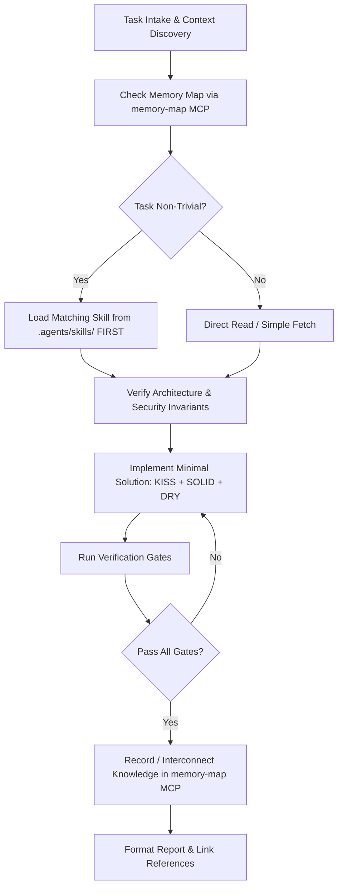

# AGENTS.md — TeamApo Hub AI Agent Operating Instructions

> **Project**: TeamApo Hub (GDG Davao Event Lifecycle Management Platform)  
> **Tech Stack**: React 19, TypeScript, Vite, Tailwind CSS, Firebase v11 (Region: `asia-southeast2`), Python 3.13 2nd-Gen Cloud Functions, Resend API  
> **Package Manager**: **BUN ONLY** (`bun run <cmd>`, `bun add <pkg>`). **NEVER use `npm`, `npx`, `yarn`, or `pnpm`.**

---

## 1. Operating Rules & Workflow Protocol

All AI coding assistants (Antigravity, Cursor, Claude Code, Gemini, Copilot) operating in this repository must follow this deterministic workflow:



### Protocol Guidelines:
1. **Load Skills First**: For any non-trivial task (UI design, refactoring, rules authoring, form validation, backend triggers), load the corresponding skill from `.agents/skills/` **before** writing code, and treat its guidance as authoritative.
2. **Consult System Documentation**: Always cross-reference [DESIGN.md](file:///Users/gab/Developer/apohub/DESIGN.md), [PRODUCT.md](file:///Users/gab/Developer/apohub/PRODUCT.md), and documentation in [docs/](file:///Users/gab/Developer/apohub/docs/):
   - [docs/Architecture.md](file:///Users/gab/Developer/apohub/docs/Architecture.md): System layout, data flows, and infrastructure.
   - [docs/Schema.md](file:///Users/gab/Developer/apohub/docs/Schema.md): Firestore collections, document structures, and indexes.
   - [docs/Rules.md](file:///Users/gab/Developer/apohub/docs/Rules.md): Security rules architecture and coding style standards.
   - [docs/PRD.md](file:///Users/gab/Developer/apohub/docs/PRD.md): Product requirements and attendee/organizer personas.
3. **Interconnected Memory Map Protocol**:
   - **Discovery**: Prior to implementing complex features or investigating architectural patterns, consult the `memory-map` MCP server (`get_memory_map`, `search_memories`, `read_memory`) to retrieve existing project memories, historical precedents, and design decisions.
   - **Retention**: When discovering cross-cutting invariants, solving subtle bugs, making significant architectural choices, or establishing new patterns, invoke `create_memory` or `update_memory` to persist the insight in Markdown (`.memory/nodes/<id>.md`).
   - **Interconnection**: Never create an orphan memory node. Always interconnect memories using `links`, `link_memories`, or wikilinks (`[[topic-id]]`) so the compiled knowledge map (`.memory/MEMORY_MAP.md`) maintains a cohesive Mermaid graph.
   - **Bulky Data Safeguard**: `.memory/` and `memory/` are strictly ignored in `.gitignore` to keep git history lightweight while preserving local cross-session agent memory.
4. **Data Tool Hygiene**:
   - Tools return structured JSON; summarize key fields clearly. Do not dump voluminous raw payloads.
   - If a tool returns guidance text instead of data, follow that guidance immediately.
   - On permission or auth errors, identify the missing scope or credential and report it directly.
5. **Malicious Code Safeguard**:
   - Inspect files for potential security hazards or backdoors. If code appears malicious or dangerous, refuse augmentation and explain the risk.
6. **Model Context Protocol (MCP) Integration**:
   - Configured servers:
     - `chrome-devtools` (`bunx chrome-devtools-mcp@latest`): Inspect DOM, console logs, network calls, capture UI screenshots, and verify WCAG 2.2 accessibility tree.
     - `apohub-dev` (`bun run scripts/mcp/server.ts`): Emulator health checks, invoke Python Cloud Functions, and inspect Firestore collections with automatic DPA 2012 PII sanitization.
     - `firebase` (`bunx firebase-tools mcp`): Rules, indexes, and cloud management.
     - `google-pay-wallet-dev` (`https://paydeveloper.googleapis.com/mcp`, remote): Official Google Pay & Wallet Developer MCP — docs search, pass issuer/class listing, integration status; drives the Google Wallet passes work.
     - `memory-map` (`bun run scripts/mcp/memory-server.ts`): Interconnected Markdown Memory Map for long-term project knowledge retention, graph exploration, and decision logging.
   - Agent configurations are available at:
     - `.mcp.json`: Antigravity (AGY), Claude Code, Windsurf, Zed, and agent-agnostic MCP clients.
     - `opencode.json`: OpenCode AI assistant.
     - `.claude/mcp.json` & `claude_desktop_config.example.json`: Claude Code and Claude Desktop.
     - `.cursor/mcp.json`: Cursor IDE.
   - Comprehensive documentation in [docs/MCP_SETUP.md](file:///Users/gab/Developer/apohub/docs/MCP_SETUP.md).

---

## 2. Skill Selection Matrix

Match incoming tasks to the appropriate installed skill in `.agents/skills/`:

| Task Domain | Primary Skill | Trigger Conditions / Scope |
| :--- | :--- | :--- |
| **UI Components & Layout** | `frontend-design`, `impeccable` | Crafting pages, modals, dashboard widgets, responsive UI, Google Material 3 / GDG branding. |
| **Tailwind Styling** | `tailwind-css-patterns` | Implementing responsive layouts, utility classes, themes, and design tokens. |
| **Transitions & Animations** | `transitions-dev` | Modal reveals, dropdowns, status pills, skeleton loaders, and micro-interactions. |
| **Accessibility (a11y)** | `accessibility` | Screen reader cues, keyboard navigation, minimum 48px touch targets, WCAG 2.2 AA audit. |
| **Forms & Input Validation** | `react-hook-form` | Multi-step attendee registrations, custom dynamic forms, inline field validations. |
| **React Architecture** | `vercel-composition-patterns`, `vercel-react-best-practices` | Component composition, reducing prop drilling, preventing unnecessary re-renders. |
| **Code Refactoring** | `refactor`, `grounded`, `ponytail` | Surgical cleanups, dead code elimination, minimal footprint, preventing over-engineering. |
| **Client-Side Authorization** | `composition-patterns` | Adding routes, gates, or `<Can>` blocks. Read `docs/Rules.md` §2.0 first: the CASL rule table and the `firestore.rules` clauses it mirrors must change together. |
| **Firestore Security Rules** | `firestore-rules-creation`, `firebase-security-rules-auditor` | Modifying `firestore.rules`, RBAC checks, field-level diff validators, rule unit tests. |
| **Backend & Cloud Functions**| `extension-to-functions-codebase`, `firebase-firestore` | Python 2nd-gen Cloud Functions in `functions/`, callable endpoints, transactional writes. |
| **Google Cloud & Firebase** | `finding-google-skills`, `firebase-basics` | Firebase CLI operations, environment configs, emulator debugging, and service accounts. |

---

## 3. Core Architectural Principles

### 3.1 KISS (Keep It Simple, Stupid)
- **Zero Premature Abstraction**: Solve today's requirement cleanly. Do not invent speculative abstractions, plugin architectures, or unrequested generic wrappers.
- **Readable & Team-Ready**: Prioritize explicit, legible code that any developer or volunteer organizer can immediately understand and debug.

### 3.2 SOLID Principles
- **Single Responsibility (S)**: Each file, hook, component, or service has one purpose. UI components render views; `src/services/*` handle business logic and Firebase API communications.
- **Open/Closed (O)**: Extend existing functionality by adding new methods or props rather than branching invasively into working logic.
- **Liskov Substitution (L)**: Implementations of contracts and service interfaces must be fully interchangeable without breaking caller expectations.
- **Interface Segregation (I)**: Keep TypeScript types, interfaces, and component props minimal, cohesive, and domain-focused.
- **Dependency Inversion (D)**: Components depend on abstractions in `src/services/*` and context providers (`src/contexts/*`), never on raw SDK instances scattered across UI files.

### 3.3 DRY (Don't Repeat Yourself)
- Extract common logic into reusable modules:
  - Business logic & API calls: `src/services/`
  - Reusable custom hooks: `src/hooks/`
  - Presentation primitives: `src/components/UI/` (`Button`, `Card`, `Modal`, `Input`, `Badge`, `SegmentedControl`)
- Never copy-paste query logic, date calculations, or badge rendering across pages.
- Centralize notifications using `react-hot-toast`. Never create ad-hoc notification mechanisms.

### 3.4 Idempotency
- **Backend Writes**: All Cloud Function callable actions, database writes, and event triggers must be idempotent. Retrying the same request (e.g. after a network drop) must not duplicate tickets, corrupt balances, or double-send emails.
- **Transactions**: Use `@firestore.transactional` (Python) or `runTransaction()` (client) when reading state to perform an atomic write (e.g., ticket capacity checks).
- **State Transitions**: Verify current entity status before applying a change (e.g., publish, archive, check-in). Skip or safely no-op if already in the target state.
- **Frontend Guards**: The shared `Button` primitive must automatically disable itself when `loading={true}` to prevent double submissions. Services must include guards against concurrent identical requests.

---

## 4. Repository Structure & Layering Boundaries

`src/pages/` is organised by **route cluster, never by role**. There is no
`admin/` or `organizer/` folder: `src/auth/ability.ts` decides what a signed-in
user may open, so a folder named after a role would assert access the code does
not actually gate. A component lives under `pages/` when exactly one route owns
it, and under `components/` when it is shared.

```
apohub/
├── src/
│   ├── auth/             # Authorization: CASL ability, AbilityProvider, RequireAbility gate
│   ├── components/       # Shared UI. UI/ is the primitive layer (import from the barrel)
│   │   ├── UI/           # Button, Input, Select, Textarea, Field, Badge, Card, Modal,
│   │   │                 # ConfirmationModal, Tabs, DataTable, EmptyState, ProgressBar,
│   │   │                 # SimpleBarChart, Skeleton, LoadingSpinner, SegmentedControl
│   │   ├── ErrorBoundary.tsx
│   │   └── FormattedLabelText.tsx
│   ├── config/           # Firebase client config & app environment constants
│   ├── contexts/         # React Contexts (AuthContext for the Firebase session)
│   ├── hooks/            # Custom reusable hooks (usePageTitle, useSEO, useMediaQuery, ...)
│   ├── layout/           # AppShell, AppNavbar, SkipLink
│   ├── pages/            # One folder per route cluster
│   │   ├── home/         # / — HomePage (PlatformHome for unscoped reads | ScopedHome for own reads),
│   │   │                 #     StatStrip, TrendPanel
│   │   ├── events/       # /events — EventListPage, EventEditorPage,
│   │   │                 #   components/ (PhotoUpload, FormBuilder, PromoCodeManager),
│   │   │                 #   workspace/ (EventWorkspacePage + tabs/*Tab, LegacyRedirect)
│   │   ├── users/        # /users
│   │   ├── auth/         # /auth/login, /auth/forgot-password
│   │   ├── registration/ # /e/:slug — RegistrationPage + components/
│   │   ├── payment/      # /payment/*
│   │   ├── feedback/     # /feedback/:eventId + FormRenderer
│   │   ├── verification/ # /verify, /verify/:code
│   │   └── errors/       # /forbidden and the * catch-all
│   ├── services/         # STRICT SERVICE LAYER: All Firestore & external API access
│   ├── types/            # Shared TypeScript type definitions (incl. ROLES)
│   └── utils/            # Pure utility functions (pricing, dates, QR, PDF)
├── functions/            # Python 3.13 2nd Gen Cloud Functions (main.py, email_service.py)
├── docs/                 # System specifications (Architecture, PRD, Rules, Schema)
├── scripts/              # Maintenance, emulator, and migration scripts
└── tests/
    ├── unit/             # Vitest unit tests (service, logic, architecture tests)
    ├── dom/              # Vitest + jsdom component render tests
    └── rules/            # Firebase Security Rules unit test suite
```

### Naming
- **`*Page.tsx` means it is a route.** The seven workspace panels are `*Tab.tsx`
  under `pages/events/workspace/tabs/`. A retired slug keeps resolving through
  `REMOVED_TAB_REDIRECTS` in `EventWorkspacePage.tsx` rather than falling through
  to Overview, which reads as "this event has no data" instead of "that screen
  moved".
- **A panel takes a required `eventId` prop** from `EventWorkspacePage`. No panel
  reads the route, and no component carries an `embedded` flag. If a component
  needs `embedded`, it is really two screens and wants to be two files.
- **Screens that differ by data scope are named for the scope, not the role**
  (`PlatformHome` vs `ScopedHome`): the difference is which Firestore
  reads they may run, which is what `firestore.rules` enforces.
- **No one-file wrapper folders.** `components/Foo/Foo.tsx` alongside
  `components/Foo/index.ts` gives one component two import paths, which is
  exactly how a primitive's geometry drifts. Make the folder only once it holds
  more than the component (its test, its styles, a subcomponent).
- **Shared types are declared once in `types/`.** Do not re-declare a shape
  next to whichever component needed it first — that is how a page ends up
  importing a type across page boundaries.

### Layering Boundary Rules:
1. **Pages/Components MUST NOT call Firestore SDK directly**:
   - `doc()`, `collection()`, `getDocs()`, `setDoc()`, `updateDoc()`, etc., belong **exclusively** inside `src/services/*`.
   - Pages and components consume service methods and hooks.
2. **Contexts Manage Global State**:
   - Authentication session state is managed via `AuthContext.tsx`. Do not query the `/users` collection repeatedly in UI components.
3. **Pure Utilities Stay Pure**:
   - Modules in `src/utils/` must be pure functions with zero side-effects and no direct Firebase dependencies.
4. **Authorization Goes Through CASL, Never Through `role` Comparisons**:
   - Add permissions in `src/auth/ability.ts`. Never write `userProfile.role === 'admin'` to decide what a user may see or do.
   - `role === 'admin'` is legitimate **only** for display text (labels, page titles) and for data filtering inside a list an account may already read.
   - **Choosing which query to run is authorization too.** `getAllEvents()` / `getDashboardStats()` / `getAllRegistrations()` are unscoped reads that only a platform-wide reader may issue; branch on `useAbility().can('read', 'all')`, never on the role string. Getting this wrong is a DPA 2012 problem, not a styling one.
   - Read `docs/Rules.md` §2.0 before adding a rule: it maps every ability rule to the `firestore.rules` clause it mirrors. `firestore.rules` stays the security boundary; CASL is UX and must never be treated as enforcement.
5. **One Import Path Per Component**:
   - Import primitives from the `@/components/UI` barrel, never by file path. Two paths for one component is how its geometry and colours drift apart across the app. `tests/unit/designSystem.test.ts` and the import-shape assertions catch regressions.
   - The barrel re-exports **primitives only**. A component owned by one page is imported by its own path from that page; `components/` and `pages/` never import from each other.

---

## 5. Strict Firestore & Data Privacy Invariants

### 5.1 Zero `undefined` in Firestore Writes (CRITICAL)
- **Constraint**: Firestore's modular SDK completely rejects write operations (`setDoc`, `addDoc`, `updateDoc`) if any field is `undefined` ("*Function setDoc() called with invalid data. Unsupported field value: undefined*").
- **Requirement**: Never assign `undefined` to fields in write payloads. Use optional property omission or explicit `null` / fallback defaults:
  ```typescript
  // BAD: May throw runtime error if note is undefined
  await updateDoc(docRef, { note: inputNote });

  // GOOD: Sanitize or omit undefined fields
  await updateDoc(docRef, { 
    note: inputNote ?? null,
    updatedAt: serverTimestamp() 
  });
  ```
- **Automated Check**: Enforced by [tests/unit/noUndefinedInWrites.test.ts](file:///Users/gab/Developer/apohub/tests/unit/noUndefinedInWrites.test.ts).

### 5.2 Scoped Reads & Philippines Data Privacy Act of 2012 (DPA 2012)
- **Constraint**: Event organizers may **ONLY** access attendee records (`registrations`) and credentials (`certificates`) for events they own (`organizerUid == request.auth.uid`).
- **Requirement**: Never execute unfiltered collection queries on `registrations` or `certificates`:
  ```typescript
  // BAD: Violates DPA 2012 and security rules
  const q = query(collection(db, 'registrations'));

  // GOOD: Always scope queries by eventId
  const q = query(collection(db, 'registrations'), where('eventId', '==', eventId));
  ```
- **Admin Opt-Out**: True platform-wide admin queries must explicitly include the inline justification comment:
  `// firestore:unscoped-ok - <reason>`
- **Automated Check**: Enforced by [tests/unit/scopedCollectionReads.test.ts](file:///Users/gab/Developer/apohub/tests/unit/scopedCollectionReads.test.ts).

### 5.3 Anonymous Attendee Privacy Model
- Attendees register without creating Firebase Auth accounts.
- Sensitive links and post-event actions (feedback, payment submission) use private token documents (`feedbackTokens`) managed server-side.
- Never expose attendee emails, phone numbers, or GCash reference numbers in public or unscoped documents.

### 5.4 Hybrid RBAC + ABPAC Alignment Invariant (CRITICAL)
- **Dual-Layer Contract**:
  - `firestore.rules` is the authoritative security boundary.
  - CASL (`src/auth/ability.ts`) is the client-side UX alignment layer that drives UI rendering, gates, and route protection.
  - **These two layers MUST remain 1:1 synchronized at all times.** If a capability, domain flag, or lifecycle condition is altered in one, the other must mirror it. Always consult and update [docs/Rules.md](file:///Users/gab/Developer/apohub/docs/Rules.md) §2.0.
- **Role Invariants**:
  - **`admin` (RBAC)**: Unrestricted platform-wide access across all routes, collections, and security rules.
  - **`organizer` (ABPAC)**: Granular functional capabilities stored on `users/{userId}.permissions` (`events`, `attendees`, `checkin`, `payments`, `certificates`, `feedback`) evaluated strictly in tandem with resource ownership attributes (`event.organizer.uid == auth.uid` or `registration.organizerUid == auth.uid`).
- **Resource Lifecycle Constraints (ABAC)**:
  - Events with `status in ['completed', 'cancelled']` are strictly frozen from updates and subcollection writes for non-administrators.
  - Force-deletion of events containing active attendee registrations is reserved exclusively for platform administrators.
- **Backward Compatibility**:
  - Existing organizer accounts without explicit `permissions` maps must inherit standard full organizer permissions (`events.canDelete: true`, etc.) without account lockout.
  - In `firestore.rules`, the `hasPerm(domain, action)` helper inspects `users/{auth.uid}.permissions` and defaults to permitted when undefined.
- **Automated Verification**: Enforced by [tests/unit/ability.test.ts](file:///Users/gab/Developer/apohub/tests/unit/ability.test.ts) (CASL matrix) and [tests/rules/firestore.rules.test.ts](file:///Users/gab/Developer/apohub/tests/rules/firestore.rules.test.ts) (Security rules unit test suite).

---

## 6. Frontend & UI/UX Standards

- **Design Tone**: Welcoming, venue-resilient, polished, and lightweight (inspired by Lu.ma and Google Material 3).
- **Venue-Resilient Usability**:
  - High-contrast text legible in both bright tropical sunlight and dim auditorium lighting.
  - Minimum **48px touch targets** for all mobile buttons, QR scanners, and form inputs.
  - Fast mobile camera check-in operations via `@zxing/browser`.
- **UI Primitives**: Always reuse shared primitives from `src/components/UI/`:
  - `Button`: Features built-in `loading` spinner and automatic double-click suppression.
  - `Modal`: Accessible dialogs with proper keyboard focus trapping and escape dismissal.
  - `Card`, `Badge`, `Input`: Consistent padding, border-radius, and typography tokens.
- **Frontend Audit**: Use the `/impeccable` skill for frontend audits, visual refinements, and responsive Polish.

---

## 7. Automated Verification Quality Gates

Every code modification must pass all local verification gates before completion. Run commands strictly using `bun`:

```bash
# 1. TypeScript type check across the entire codebase
bun run typecheck

# 2. ESLint check for code style and hook rules
bun run lint

# 3. Unit and architecture test suite (Vitest)
bun run test:unit

# 4. Production build verification (Vite)
bun run build

# 5. Security rules unit tests (when touching firestore.rules or storage.rules)
bun run test:rules
```

> [!IMPORTANT]
> **CREATE TESTS FOR NEW FUNCTIONALITY**: When adding new service methods, utilities, or data transformations, always add corresponding test suites in `tests/unit/<feature>.test.ts`.

---

## 8. Human Confirmation Protocol (When to Ask)

To protect system integrity, data privacy, and production infrastructure, agents **MUST ASK FOR EXPLICIT USER CONFIRMATION** before performing any of the following actions:

1. **Security & Authorization Rules**:
   - Modifying `firestore.rules` or `storage.rules`.
   - Modifying role validation helpers or changing attendee/organizer permission scopes.
2. **Schema & Index Changes**:
   - Modifying `firestore.indexes.json` or changing composite index structures.
   - Adding, dropping, or renaming Firestore collections or subcollections.
3. **Data Migrations & Scrubbing**:
   - Executing scripts that alter existing database documents (e.g. `scripts/backfill-*`, `scripts/scrub-*`).
4. **Destructive Operations**:
   - Deleting collections, database records, source files, or dependencies.
   - Performing major structural refactors that break existing public API contracts.

*For standard feature implementations, bug fixes, UI enhancements, and unit test creation conforming to existing architecture, agents may proceed autonomously while reporting changes clearly.*
