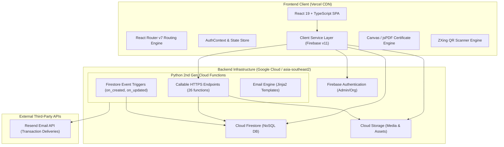
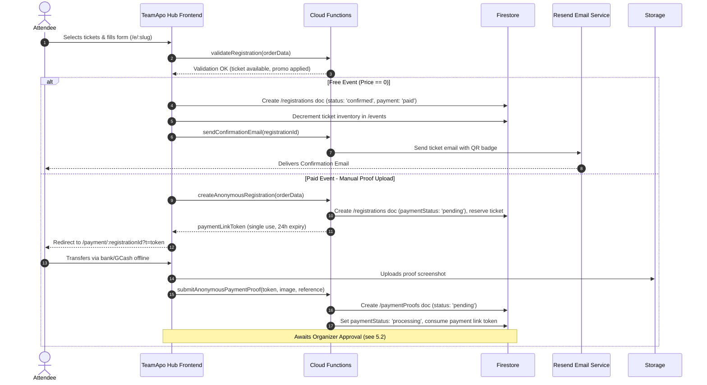
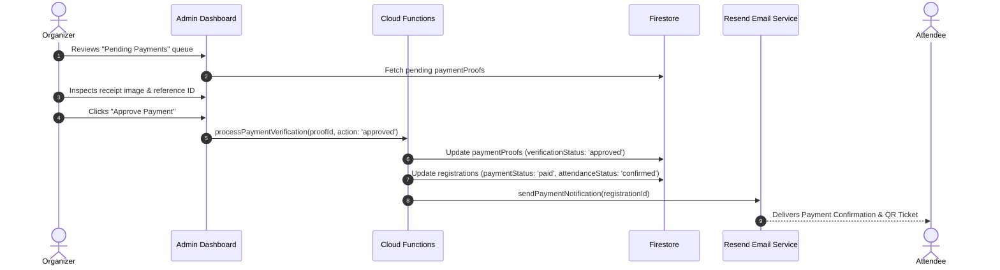
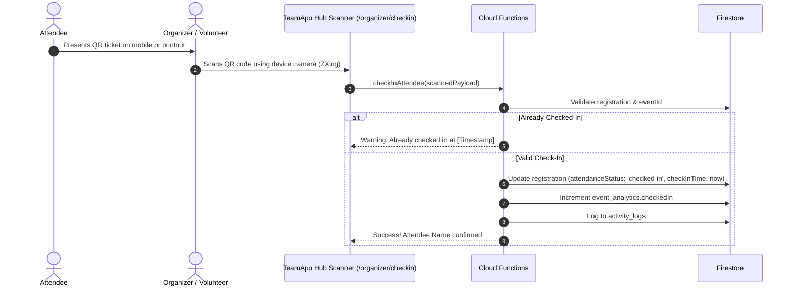
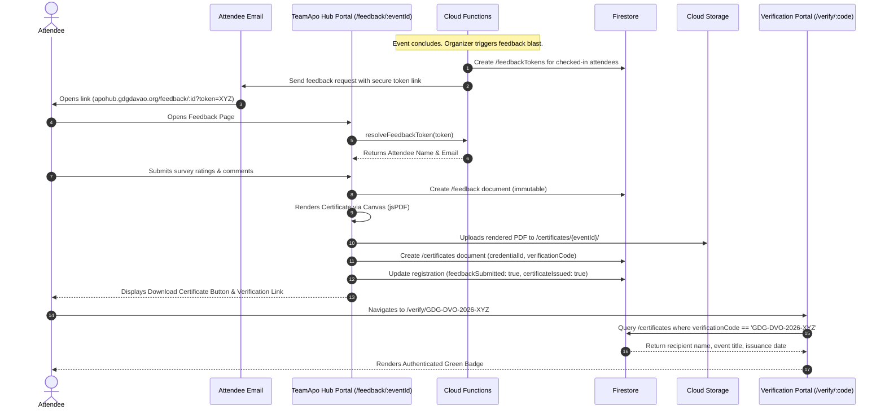

# TeamApo Hub System Architecture Documentation

This document provides a comprehensive technical architecture overview of **TeamApo Hub**, the event lifecycle management platform engineered for the **Google Developer Group (GDG) Davao** community.

---

## 1. Executive Summary & Architectural Overview

TeamApo Hub is a modern, serverless cloud platform built to automate and centralize all stages of event operations:

* **Event Design & Publication**: Rich event configuration, multi-tier ticketing, custom registration forms, and speaker showcases.
* **Frictionless Registration**: Attendee registration without mandatory account creation.
* **Payments**: Manual verification — bank transfer / GCash receipt upload feeding an organizer review queue that releases the ticket. No third-party payment gateway is integrated.
* **On-Site Operations**: Camera-based QR code badge check-in with real-time analytics.
* **Automated Communications**: Context-aware transactional emails (confirmations, QR tickets, 24h/1h reminders, post-event feedback invitations) sent via Resend.
* **Post-Event Workflows**: Token-secured survey feedback, dynamic PDF certificate generation, and an open verification portal.



---

## 2. Technology Stack & Specifications

### 2.1 Frontend Stack
* **Framework**: [React 19.2](https://react.dev) + [TypeScript 5.7](https://www.typescriptlang.org)
* **Build Tool & Bundler**: [Vite 6.3](https://vitejs.dev) with Fast Refresh
* **Styling**: [Tailwind CSS 3.4](https://tailwindcss.com) with Google Material / Google Developer Group brand color palette
* **Routing**: [React Router 7.0](https://reactrouter.com) (Browser Router with declarative nested routes and layout wrappers)
* **Forms & Validation**: [React Hook Form 7.54](https://react-hook-form.com)
* **Icons & UI Primitives**: `@heroicons/react 2.2`, `lucide-react 0.46`, `@headlessui/react 2.2`
* **Client-Side QR Operations**: `@zxing/browser 0.1.5` (camera barcode scanning) + `qrcode 1.5.4` (SVG/Canvas generation)
* **Certificate Rendering**: `jspdf 2.5.2` + `html2canvas 1.4.1` + HTML5 Canvas API
* **Analytics**: `@vercel/analytics 1.5.0`

### 2.2 Backend & Cloud Services
* **Cloud Provider**: Google Cloud Platform / Firebase
* **Region**: `asia-southeast2` (Jakarta) — pinned globally across Firestore, Cloud Functions, and Cloud Storage for minimal latency in the Philippines
* **Database**: Cloud Firestore (Enterprise NoSQL database with client and server SDKs)
* **Object Storage**: Cloud Storage for Firebase (isolated buckets for event banners, templates, payment proofs, and certificates)
* **Serverless Compute**: Python 2nd Generation Cloud Functions (`firebase-functions 0.4.3`, `firebase_admin 7.1.0`, `Flask 3.1.2`, `functions-framework 3.9.2`) running on Google Cloud Run
* **Templating Engine**: `Jinja2 3.1.6` for responsive HTML email rendering

### 2.3 External Integrations
* **Payment Gateway**: None. Payment methods (bank transfer, GCash) are configured per event by the organizer and settled offline; release of a ticket is gated on manual proof review.
* **Email Service**: [Resend](https://resend.com) API (DKIM/SPF-verified domain sending with delivery webhook tracking).
* **Google Wallet API**: Signed JWT Save links for digital event passes (`GenericPass` / `GenericObject`) signed via Google Cloud Service Account credentials (`WALLET_ISSUER_KEY`).

Attendee feedback sentiment is summarised locally in `services/feedbackService.ts`
(a keyword-counting heuristic), not by a third-party model: attendee free-text
comments stay inside the platform rather than being shipped to an external
inference API.

---

## 3. Frontend Architecture

### 3.1 Application File Structure

`src/pages/` is organised by **route, not by role**. There is no `admin/` or
`organizer/` folder: which areas a signed-in user may open is decided by the CASL
ability at the route gate, so a folder named after a role would be a claim about
access that the code does not actually make. A component sits in `pages/` when
exactly one route owns it, and in `components/` when it is shared.

```
src/
├── App.tsx                      # Root route configuration & layout definitions
├── main.tsx                     # React DOM entry point
├── config/
│   ├── firebase.ts              # Firebase Client SDK initialization & emulator detection
│   └── app.ts                   # Canonical APP_URL + QR verification hosts
├── auth/                        # Authorization: permission model, provider, route gate
│   ├── ability.ts               # Pure CASL rule table + entity tagging helpers
│   ├── AbilityProvider.tsx      # Publishes the signed-in user's ability
│   └── RequireAbility.tsx       # Route gate; RequireAnonymous for the sign-in area
├── contexts/
│   └── AuthContext.tsx          # Firebase session + live users-document profile
├── hooks/                       # usePageTitle, useSEO, useMediaQuery, useReducedMotion
├── types/
│   └── index.ts                 # Central TypeScript interfaces, ROLES, and data models
├── services/                    # Domain-driven service layer (cross-cutting, never page-local)
│   ├── analyticsService.ts      # Event analytics aggregation and metrics
│   ├── certificateService.ts    # Template composition, verification, and retrieval
│   ├── emailService.ts          # Email dispatch calls and activity log queries
│   ├── eventService.ts          # Event CRUD, slug resolution, and capacity tracking
│   ├── feedbackService.ts       # Survey validation, token exchange, and analytics
│   ├── paymentService.ts        # Manual proof upload & verification workflow
│   ├── registrationService.ts   # Atomic ticket checkout, reservation, check-in, and tier transfer
│   ├── userService.ts           # User and role administration
│   └── walletPassService.ts     # Google Wallet pass signed URL invocation
├── layout/                      # The chrome every workspace page wraps itself in
│   ├── AppShell.tsx             # Page frame: emits <h1>, hosts the navbar and skip link
│   ├── AppNavbar.tsx            # Top navigation
│   └── SkipLink.tsx             # Keyboard bypass for the nav
├── components/                  # Genuinely shared UI
│   ├── UI/                      # The primitive layer. Import from here, never by file path
│   │                            # Button, Input, Select, Textarea, Field, Badge, Card,
│   │                            # Modal, ConfirmationModal, Tabs, DataTable, EmptyState,
│   │                            # ProgressBar, SimpleBarChart, Skeleton, LoadingSpinner,
│   │                            # SegmentedControl
│   ├── TicketCard.tsx           # Canonical Material 3 digital ticket credential card
│   ├── ErrorBoundary.tsx        # Mounted once by App.tsx
│   └── FormattedLabelText.tsx   # Renders the **bold** / _italic_ subset used by form labels
├── utils/                       # Pure utilities (no direct Firebase SDK calls)
│   ├── ticketCanvas.ts          # 2D Canvas pixel-accurate PNG ticket exporter
│   ├── passArtwork.ts           # Deterministic SHA-256 artwork selector and iOS detector
│   ├── qrCode.ts                # Pure SVG vector QR generator
│   └── formResponses.ts         # Custom form response formatting and validation
└── pages/                       # One folder per route cluster
    ├── home/                    # / (canonical Home)
    │   ├── HomePage.tsx         # Dispatches by permission, not by role
    │   ├── StatStrip.tsx, TrendPanel.tsx
    │   ├── platform/            # Reads every event, registration and certificate
    │   └── scoped/              # Reads only what this user owns
    ├── events/                  # /events, /events/create, /events/edit/:id, /events/:id/:tab
    │   ├── EventListPage.tsx    # Platform-wide event list
    │   ├── EventEditorPage.tsx  # Create and edit; isEditMode keys off the route
    │   ├── components/          # PhotoUpload, FormBuilder, PromoCodeManager
    │   ├── kiosk/               # /events/:id/kiosk self-check-in station
    │   └── workspace/
    │       ├── EventWorkspacePage.tsx  # Loads the event, checks `manage`, renders tabs
    │       ├── LegacyRedirect.tsx      # /attendees, /check-in, ... forwarders
    │       └── tabs/            # One panel per tab; each takes a required `eventId`
    │           ├── OverviewTab.tsx, AttendeesTab.tsx, CheckInTab.tsx,
    │           │   PromoCodesTab.tsx, CertificatesTab.tsx, FeedbackTab.tsx,
    │           │   SettingsTab.tsx
    │           ├── RegistrationDetailsModal.tsx  # Attendee view: payment proof, email history, tier transfer
    │           ├── WalkInRegistrationModal.tsx, ForceCheckInModal.tsx
    │           └── FeedbackEmailStatus.tsx
    ├── users/                   # /users
    ├── auth/                    # /auth/login, /auth/forgot-password (no self-signup)
    ├── registration/            # /e/:slug and /events/:id/register
    │   └── components/          # RegistrationModal, RegistrationForm, TicketSelector, Reveal
    ├── payment/                 # /payment/:registrationId
    ├── ticket/                  # /ticket?reg=...&token=... (and /payment/success legacy redirect)
    │   ├── TicketPage.tsx       # Gated attendee ticket with Google Wallet + Image Save
    │   └── LegacyTicketRedirect.tsx
    ├── feedback/                # /feedback/:eventId
    │   └── components/          # FormRenderer (renders the survey a submitter sees)
    ├── verification/            # /verify, /verify/:code
    └── errors/                  # /forbidden, and the * catch-all
```

Four consequences worth naming, because all four used to be violations:

- **Nothing in `pages/` is named `*Page` unless it is a route.** The eight
  workspace panels are `*Tab` and live under `workspace/tabs/`. Each takes a
  required `eventId` prop supplied by `EventWorkspacePage`, so none of them reads
  the route or carries an `embedded` flag.
- **No one-file wrapper folders.** `components/Foo/Foo.tsx` plus a
  `components/Foo/index.ts` is two import paths for one component, which is how
  geometry drifts. A component folder is only worth having once it holds more
  than the component (its test, its styles, a subcomponent).
- **`components/` never imports from `pages/`, and vice versa.** The primitive
  barrel re-exports primitives only; a page-owned component is imported by its
  own path from the page that owns it.
- **Types live in `types/`, not next to the first component that needed them.**
  `FormField` was declared twice — in `pages/events/components/FormBuilder.tsx`
  and in `types/index.ts` — which had the feedback page importing a type across
  page boundaries. One declaration, imported from `types/`.
- **Screens that differ by data scope are named for the scope, not the role.**
  `platform/PlatformHome` and `scoped/ScopedHome` are chosen by
  `<Can do="read" on="User">`; the distinction is which Firestore reads they are
  allowed to run, which is what `firestore.rules` actually enforces.

### 3.2 Routing & Access Control Hierarchy

Routes use a **single role-neutral namespace**. Data scoping — not route paths —
is what separates admins from organizers, so a new page only needs one route.

Authorization is a **CASL ability** built in `src/auth/ability.ts` from the
signed-in user's profile. It is a UX layer: `firestore.rules` remains the only
security boundary. `RequireAbility` reads it and turns a denial into a
destination.

| Route | Gate | Page |
| :--- | :--- | :--- |
| `/auth/login`, `/auth/forgot-password` | `RequireAnonymous` | Sign in, password reset |
| `/login`, `/signup` | — | Legacy aliases redirecting to `/auth/login` |
| `/` | `RequireAbility read Event` | `HomePage` picks the platform or scoped home (`/dashboard` redirects to `/`) |
| `/events`, `/events/create`, `/events/edit/:eventId` | `RequireAbility read all` | Platform-wide event list and editor (admin only) |
| `/events/:eventId`, `/events/:eventId/:tab` | `RequireAbility read Event`, then `EventWorkspacePage` checks `manage` against the loaded event | Per-event workspace |
| `/events/:eventId/kiosk` | `RequireAbility checkin Event` | On-site attendee self-check-in kiosk mode |
| `/attendees`, `/check-in`, `/payments`, `/emails`, `/analytics`, `/certificates` | `RequireAbility read Event` | Legacy forwarders into the workspace tab of the same name |
| `/users` | `RequireAbility read User` | User administration (admin only) |
| `/forbidden` | open | Signed in but not permitted; says which role was needed |
| `/e/:slug`, `/events/:eventId/register`, `/payment/:registrationId` | open | Attendee discovery, registration, and payment |
| `/ticket` | open (token-gated) | Attendee digital ticket with Google Wallet save and offline PNG download |
| `/payment/success` | open | Legacy payment redirect forwarder to `/ticket` |
| `/feedback/:eventId`, `/verify`, `/verify/:code` | open | Attendee feedback and certificate verification |
| `*` | — | 404 |

Two distinctions the gate depends on:

- **Authentication and permission are different failures.** Signed out goes to
  the login form carrying `?from=`, so a deep link survives the detour.
  `LoginPage` re-validates `?from=` rather than trusting it. Signed in without
  permission goes to `/forbidden`, which can explain why.
- **Communal Event Architecture**: Events belong to the organization rather than individual creators. All active organizers have access to all events, with functional actions governed strictly by RBAC (admin vs organizer) and ABPAC (`users/{uid}.permissions`). Event deletion is strictly admin-only (`allow delete: if isAdmin()`).

`tests/unit/routeIntegrity.test.ts` parses the route table and fails the build if any
`Link`/`navigate` target does not resolve, so a stale path cannot reach production.
`tests/unit/ability.test.ts` pins the rule table,
`tests/dom/requireAbility.test.tsx` pins the gate's four outcomes, and
`tests/unit/importShape.test.ts` pins the three structural rules in §3.1 (no
one-file wrapper folders, no `components/` ↔ `pages/` coupling, no primitives
imported by path).

**Communal Data Governance**: `registrations`, `feedback`, and `activity_logs` are accessible across the organizer team based on granular domain permissions (`attendees.canRead`, `feedback.canRead`, etc.), enabling seamless collaboration across events while maintaining least-privilege security. Existing documents with legacy `organizerUid` can be cleaned using `scripts/strip-event-ownership.cjs`.

### 3.3 Dynamic Certificate Engine
Certificates are generated via client-side composition or Cloud Functions:
1. The background artwork (`certificateTemplates/{templateId}`) is retrieved from Cloud Storage.
2. An off-screen HTML5 Canvas draws the high-resolution background (1920x1080 or custom dimensions).
3. The engine dynamically maps:
   * Recipient full name with automatic font scaling to prevent overflow.
   * Event title, dates, and organizers' signatures.
   * A cryptographic QR code encoding the public verification URL (`/verify/{verificationCode}`).
4. The canvas exports a lossless PNG/PDF that is uploaded directly to `certificates/{eventId}/{filename}` in Cloud Storage and indexed in Firestore.

---

## 4. Serverless Backend Architecture (Python Cloud Functions)

The serverless backend in `functions/main.py` is implemented using **Python 3.13** and Google Cloud Functions 2nd Generation (built atop Google Cloud Run).

### 4.1 Function Endpoints Catalog

#### Event & Catalog Management
* `validate_event_data` / `validateEventData`: Validates event payload dates, ticketing limits, and required fields.
* `initialize_event`: Seeds default subcollections, forms, and analytics documents for a new event.
* `publish_event`: Atomic publishing toggle with sanity validation.
* `duplicate_event`: Deep-copies an existing event document and its ticket configurations.
* `deleteEventData`: Cascading deletion of event subcollections, registrations, proofs, and analytics.
* `get_event_statistics` / `getEventStatistics` / `getEventAnalytics`: Real-time calculation of ticket velocity, gross volume, and check-in rates.

#### Registration & Payments
* `createAnonymousRegistration`: Transactionally creates an attendee registration, verifies capacity and ticket tier availability, validates promo codes, and generates a CSPRNG `walletPassToken`.
* `validateRegistration`: Verifies ticket availability, promo code validity, and order limits.
* `validatePromoCode`: Validates a promo code against `events/{eventId}/config/promoCodes` server-side without leaking secret codes or usage quotas.
* `registerForEvent`: Atomically records the registration, updates ticket sales counts, and dispatches confirmation emails.
* `processPaymentVerification`: Admin approval/rejection of manual payment proofs; transitions registration status to `'paid'` and sends ticket email.
* `bulkProcessPayments`: Batch approval for high-volume registration queues.

#### Digital Passes & Google Wallet
* `getTicketPass`: Public token-gated endpoint resolving ticket details for approved attendees using their `walletPassToken` with zero PII exposure.
* `createWalletPassUrl`: Generates signed Google Wallet Save URLs via JWT using service account credentials (`WALLET_ISSUER_KEY`).

#### Attendance & Feedback
* `checkInAttendee`: Validates scanned QR payload, updates `attendanceStatus = 'checked-in'`, records `checkInTime`, and creates an activity log.
* `resolveFeedbackToken`: Resolves a one-time token into attendee details without exposing emails in the client URL.
* `submitFeedback`: Validates survey responses, stores feedback immutably, and triggers certificate generation.
* `sendFeedbackRequest`: Sends an individual post-event feedback invitation email.
* `resendEventFeedbackRequests`: Broadcasts feedback invitations to all attendees marked `'checked-in'` for an event.

#### Digital Credentials & Verification
* `generateCertificate`: Server-side fallback rendering and indexing of digital certificates.
* `sendCertificateNotification`: Dispatches the completed certificate notification with direct verification and download links.

#### User Administration & Security
* `deleteUser`: Admin-only callable for deleting Auth user identities and Firestore profile documents with last-admin, superuser, and self-delete protections.

#### Communications & Monitoring
* `sendConfirmationEmail`: Dispatches registration confirmation with embedded QR check-in ticket.
* `sendPaymentNotification`: Dispatches receipt or payment instructions.
* `sendEventReminder`: Scheduled/manual broadcast sent 24h and 1h prior to event start.
* `sendCheckInNotification`: Sends a welcome email upon badge check-in at the venue.
* `getResendEmailStatus` / `getAllResendEmails`: Connects to Resend API to retrieve live delivery, bounce, and open metrics.
* `health_check`: HTTP probe for uptime monitors.

### 4.2 Event-Driven Firestore Triggers
* `on_event_created` (`events/{eventId}`): Automatically provisions initial analytics documents and audit logs upon new event creation.
* `on_event_updated` (`events/{eventId}`): Watches for critical changes (e.g. status transition to `'cancelled'` or date changes) and triggers automated attendee broadcast alerts.

---

## 5. Core System Workflows

### 5.1 Attendee Registration & Payment Processing



---

### 5.2 Manual Payment Review Workflow



---

### 5.3 On-Site QR Check-In Workflow



---

### 5.4 Feedback Submission & Dynamic Certificate Verification



---

## 6. Deployment, Environments & Infrastructure

### 6.1 Multi-Environment Setup
| Parameter | Local Emulator Environment | Production Environment |
| :--- | :--- | :--- |
| **Frontend Host** | Vite Dev Server (`localhost:5173`) | Vercel Edge Network (`apohub.gdgdavao.org`) |
| **Auth** | Firebase Auth Emulator (`localhost:9099`) | Google Identity Toolkit |
| **Firestore** | Firestore Emulator (`localhost:8080`) | Cloud Firestore (`asia-southeast2`) |
| **Cloud Functions** | Functions Emulator (`localhost:5001`) | Cloud Functions v2 / Cloud Run (`asia-southeast2`) |
| **Storage** | Storage Emulator (`localhost:9199`) | Cloud Storage Bucket (`apohub-gdgdavao.appspot.com`) |

### 6.2 Build & Deployment Automation
The repository includes deployment scripts for all subsystems:

```bash
# Full local development stack (frontend + all emulators)
bun run dev:full

# Deploy Cloud Functions
bun run firebase:functions

# Deploy Firestore Security Rules & Indexes
bun run firebase:rules
bun run firebase:indexes

# Deploy Frontend to Vercel
vercel --prod
```
