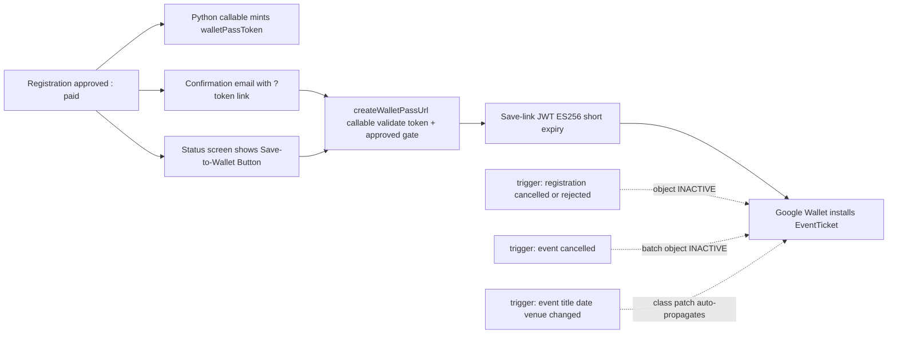

# SPEC — Google Wallet Tickets for Approved Attendees

> **Status**: Approved for implementation (design decisions confirmed; no code written yet)
> **Scope**: Google Wallet `EventTicket` passes issued to approved/paid registrations on TeamApo Hub (GDG Davao).
> **Contribution note**: This is an open-source repo. All issuer identifiers, keys, and account-specific values are placeholders — fill them in your own environment. Nothing secret is ever committed.

---

## 0. Resolved Design Decisions

Recorded from the design interview that produced this spec.

| # | Decision | Choice | Key rationale |
|---|----------|--------|---------------|
| 1 | Pass type & trigger | **Google Wallet `EventTicket`**, issued at the approval gate (`registrationStatus == 'approved'` ∨ `paymentStatus == 'paid'`) | The registration document **is** the ticket; the pass QR reuses `registrations.qrCode`, so door check-in is unchanged. Certificates are a separate, feedback-gated post-event flow and are deliberately out of scope. |
| 2 | Trigger UX | **Attendee-initiated + email link** | The callable returns a *fresh signed Save link on demand* — idempotent by construction: no stored link to expire, no re-mint-on-expiry logic, no duplicate-pass risk on retries. |
| 3 | Key storage | **Firebase Functions Secret Manager** (`secrets=["WALLET_ISSUER_KEY"]`) | `os.getenv` read mirrors the existing `RESEND_API_KEY` pattern; declarative, per-function scoped, emulator picks secrets up. A long-lived private key never sits in plain `.env`. |
| 4 | Pass visuals | **Token-defaulted auto visuals** | Class auto-derived from the event doc; GDG blue `#0b57d0`; event banner from Storage `events/{eventId}/images` with GDG Davao fallback art in `Storage system/`. No new template UI in v1 (see §11 for the `walletPassTemplates` future). |
| 5 | Lifecycle sync | **Minimal truthful-sync triggers** | Cancel/reject → object `INACTIVE`; event cancelled → batch `INACTIVE`; event date/venue/title change → one class patch (auto-propagates to all saved objects). |
| 6 | Owner auth (anonymous attendees) | **`walletPassToken` minted server-side at the approval moment** | Matches the existing `feedbackTokens` / `paymentLinkToken` pattern; callable validates token + re-checks the approved gate; organizers act through CASL abilities. |
| 7 | Issuer dependency | **Spec now, gate at runtime** | Issuer approval is external and slow; app features degrade gracefully to the existing QR credential until configured. |
| 8 | Device reach | **Google Wallet only + in-app Ticket Card QR fallback (progressive enhancement)** | The in-app Ticket Card ([docs/PassUI.md](./PassUI.md)) is the canonical credential on every platform; Apple Wallet is explicitly skipped. |
| 9 | Spec location | **`docs/GoogleWalletPasses.md`** | Matches the existing `docs/` convention. |

---

## 1. Prerequisites & Contributor Setup Checklist

Complete these once per Google Cloud project / Wallet Issuer. All values below are **placeholders**.

1. **Google Wallet Developer account** — apply at the Google Pay & Wallet Console (business merchant application; manual approval).
2. **Issuer ID** — assigned by Google after approval. Placeholder: `WALLET_ISSUER_ID` (e.g. `<ISSUER_ID>`).
3. **Service account for Wallet API access** — create it in the same GCP project, grant it the **"Wallet Object Issuer"** role, download the JSON key.
4. **Pass artwork** — the 10 pass hero images live in a **public Cloudflare R2 bucket** (see [docs/PassUI.md](./PassUI.md) §3 — immutable URLs, no attendee data in URLs); the GDG Davao logo stays in `Storage system/`. Both must be publicly fetchable by Google's ingestion server and by attendee browsers (see §12 open items).
5. **Upload the issuer key once**:
   ```bash
   firebase functions:secrets:set WALLET_ISSUER_KEY   # paste the JSON key file content
   ```
6. **Issuer ID runtime config** (Firebase 2nd Gen uses `.env` in `functions/`):
   In `functions/.env`:
   ```bash
   WALLET_ISSUER_ID="<ISSUER_ID>"
   ```
   *(For local emulator debugging, add to `functions/.env.local`)*

**Feature state rule**: the feature is considered *"not configured"* until **both** `WALLET_ISSUER_KEY` and the issuer ID are present. In that state the callable returns the typed error `wallet-not-configured` and the UI falls back to the existing QR credential (§7.3). Nothing else in the app blocks on Wallet.

---

## 2. System Context (existing facts this spec builds on)

- **The registration document is the ticket.** `registrations.qrCode` (opaque `REG-<ts>-<rand>-<regIdPrefix>` string) is validated at the door by `RegistrationService.verifyQRCode` (`src/services/registrationService.ts`), which checks the code and that the event is on that day. There is no separate ticket entity, and we will not introduce one.
- **Approval gate**: `registrationStatus: 'approved'` and/or `paymentStatus: 'paid'` resolve to *confirmed* in `src/utils/registrationStatus.ts` (`resolveDisplayStatus`, `countPendingRegistrations`). Every "approved attendee" assertion in this spec keys off those two flags only.
- **Backend-minted opaque tokens** are the established pattern for anonymous attendees: `paymentLinkToken` inline on the registration (minted transactionally in `createAnonymousRegistration`, `functions/main.py`) and `feedbackTokens/{token}` — both `secrets.token_urlsafe(32)` minted by Python Cloud Functions and consumed once.
- **Canonical app URL** — single source of truth in `src/config/app.ts` (`APP_URL`; QR payloads, feedback deep links, verify hosts all read from it). Wallet links join this family; QR/pass payloads always use the canonical domain, never preview URLs.
- **Functions runtime**: Python 3.13, 2nd gen, region `asia-southeast2`, `set_global_options(region="asia-southeast2", max_instances=10)`, Admin SDK via ADC. Deploy with `bun run firebase:functions`.
- **Web deploy**: Vercel SPA (`vercel.json`, `dist` output, SPA rewrite), social-bot SSR via `api/event-meta.ts`.
- **Invariants that still apply**: zero `undefined` in Firestore writes (AGENTS.md §5.1); scoped reads / DPA 2012 (§5.2); anonymous attendee privacy model (§5.3); RBAC+ABPAC 1:1 sync between `firestore.rules` and CASL (§5.4); no gradient styling (repo policy); shared `Button` primitive with `loading` + double-click suppression.

---

## 3. Architecture Overview

```
Attendee (no Firebase Auth account)
  [A] registration transitions to approved/paid
        → server mints registrations.walletPassToken (once, transactionally)
        → approval email includes Save link (?token=…)
        → payment-success / status screens show "Save to Google Wallet" button
  [B] attendee clicks Save
        → callable createWalletPassUrl({ registrationId, walletPassToken })
        → validates token + approval gate → get-or-patch class + object (Wallet API)
        → signs ES256 Save-link JWT (exp ≈ 15 min) → returns saveUrl
        → Google's save page installs the pass into the attendee's Wallet app
  [C] lifecycle triggers keep saved passes truthful (§6.2–6.3)
```



**Idempotency (critical)**
- *Saving is click-through, not a stored link*: the JWT/Save link is generated per call with a short expiry. Clicking again re-fetches a fresh link; retries cannot duplicate passes (object IDs are deterministic, §5).
- *Token minting is transition-keyed*: mint only the first time a registration transitions into approved/paid and only if `walletPassToken` is absent. **Never rotate** — rotation invalidates links the attendee may have already saved/shared.
- *Class/object identifiers are deterministic* (§5): re-running ensure-class/ensure-object for the same event/registration is an upsert of the same IDs; nothing accumulates in the Wallet API.

---

## 4. Pass Visuals (token-defaulted, auto-derived)

One **`EventTicket` class per event**. The class is created/patched server-side (`ensureEventClass`, §6.1) on the first Save call per event and by the event-change trigger (§6.3). Attendee-facing objects never override class visuals in v1.

| Class field | Source |
|---|---|
| `eventName.default` | `events.title` |
| `dateTime.start` / `.end` | `events.startAt` / `events.endAt` (existing event document fields) |
| `venue.name` | venue fields on the event document (name, address) |
| `hexBackgroundColor` | `#0b57d0` (GDG blue primary token — venue-legible, matches DESIGN.md) |
| `logo` | GDG Davao logo from `Storage system/` |
| `heroImage` | **one of the 10 Cloudflare R2 artworks, selected deterministically per registration** — see [docs/PassUI.md](./PassUI.md) §3 (the in-app Ticket Card and the Wallet pass always show the same artwork). Apple Wallet is out of scope entirely: non-Wallet users are served by the in-app card's QR. |
| Object label rows (≤3) | attendee's ticket type name, quantity, and "GDG Davao" |

- Label rows pull from the registration: `ticketTypeId → events.ticketTypes[].name` and `quantity` (both already on the registration document).
- No gradient styling anywhere (repo policy). Colors come from the existing design-token ramp.
- Any per-event *custom* pass artwork is explicitly deferred to the `walletPassTemplates` future (§11) — Wallet renders its own layout around whatever image is provided, so v1 artwork is pragmatic, not bespoke.

---

## 5. Identifier Mapping (Google Wallet model ↔ platform)

| Platform entity | Google Wallet entity | ID |
|---|---|---|
| `events/{eventId}` | `EventTicketClass` | `WALLET_ISSUER_ID.gdgDavaoEvent_<sanitizedEventId>` |
| `registrations/{regId}` | `EventTicketObject` | `WALLET_ISSUER_ID.reg_<regId8>` |
| `registrations.qrCode` | object `barcode: { type: QR_CODE, value }` | the same code that door check-in scans |

- IDs are **deterministic and sanitized** (safe slug-fold of the Firestore ID, same spirit as existing ID hashing in the codebase) — re-derivable from platform data at any time, no ID storage on the platform side.
- The attendee's **name** appears on the object (required attendee field) — this is the PII the owner-auth branch (§6.1, §8) protects.

---

## 6. Backend — Cloud Functions (`functions/main.py` + modules)

All Wallet logic lives server-side. The browser signs nothing.

### 6.1 Callable — `createWalletPassUrl`

Declared with `@https_fn.on_call(secrets=["WALLET_ISSUER_KEY"])`.

**Input**: `{ registrationId: string, walletPassToken: string }`

**Flow**:
1. Look up the registration by `where('walletPassToken', '==', token)` (one hit max). Do **not** look up by `registrationId` first: token mismatch must return the same not-found behavior (no enumeration, no timing difference).
2. Re-check the approval gate (`registrationStatus == 'approved'` ∨ `paymentStatus == 'paid'`). This server check is the security boundary; CASL is UX alignment only.
3. If the issuer key / issuer ID are absent → return typed error `wallet-not-configured`.
4. `ensureEventClass(eventId)` — get-or-patch the class in the Wallet API (idempotent upsert: patch only fields that differ).
5. get-or-update the object (`state == 'INACTIVE'` → recreate to `ACTIVE` if the registration is again eligible, else return its state).
6. Build the Save-link JWT:
   - `iss` = service-account email, `aud` = `google`, `typ` = `savetowallet`
   - `iat` = now, `exp` = now + **15 minutes**
   - `payload.eventTicketObject` (references the class); sign `ES256` with the issuer key.
7. Return `{ saveUrl, expiryAt }` (`saveUrl` = `https://wallet.google.com/manage/w/…/save?wltc=<encoded JWT>`).
8. Emit one audit-log row (existing `auditLogService` pattern) keyed to the registration — never log the token itself.

**Failure modes → typed callable errors**: `not-found`, `not-approved`, `wallet-not-configured`, `upstream` (Wallet API errors mapped to a human message + code). The callable inherits `max_instances=10` from `set_global_options`.

### 6.2 Trigger — registration lifecycle sync

`onDocumentUpdated` handler for `registrations`:
- `status → cancelled | rejected` (any transition out of confirmed) ⇒ patch that object's `state = INACTIVE` in the Wallet API. One document → one deterministic object ID; direct patch, no fan-out.

### 6.3 Trigger — event lifecycle/property sync

`onDocumentUpdated` handler for `events`:
- **`status → cancelled`** ⇒ query the event's registrations (event-scoped internal read) and batch-patch their objects to `INACTIVE`. Latency is acceptable; this is an admin-triggered, rare path.
- **`title | dateTime | venue` changed** ⇒ `ensureEventClass` patch of *only the changed fields*. Date/time and venue live on the **class**, so every already-saved pass updates itself — no per-object fan-out for content changes.

### 6.4 Minting `walletPassToken` at the approval moment

Mint `walletPassToken = secrets.token_urlsafe(32)` **on the first transition** of a registration into the approval gate, in every approval path:

| Path | File |
|---|---|
| Server payment verification (Python) | `processPaymentVerification` (`functions/main.py`) |
| Organizer approval from the web client | `PaymentService.verifyPaymentProof` (`src/services/paymentService.ts`) — the client twin |
| Organizer status decision (`approved` without payment) | `RegistrationService.updateRegistrationStatus` (`src/services/registrationService.ts`) |

Semantics:
- Mint **only if absent** on the document (strict "if not exists" write semantics inside the same transactional/update write that sets the status). Overlapping code paths de-dupe naturally; re-approvals never rotate the token.
- The mint rides the **existing** write — no extra round-trip, no new trigger service just for minting.
- Zero `undefined` values in payloads (AGENTS.md §5.1); `serverTimestamp()` companions where applicable.

### 6.5 Firestore rules — expected change: none

`walletPassToken` is a server-managed field on the `registrations` document, the same treatment as `paymentLinkToken`. The existing rules already block client writes to that field family and allow the same token-lookup read patterns. The rules test suite (§10) verifies no regression. If, during implementation, a rules clause needs touching, that requires explicit user confirmation per AGENTS.md §8 before modifying `firestore.rules`.

### 6.6 Emulator / local dev behavior

- Without `WALLET_ISSUER_KEY` / issuer ID the callable returns `wallet-not-configured`; the front-end shows a clean disabled state ("Wallet not yet available") instead of attempting the real API.
- Unit tests cover the token-minting logic, ID sanitization, and the not-configured branch with the SDK mocked — the test suite never reaches the live Wallet API.

---

## 7. Frontend (`src/services/` + surfaces)

### 7.1 New service — `src/services/walletPassService.ts`

- `WalletPassService.createWalletPassUrl({ registrationId, token })` → thin typed wrapper over the callable; narrow error union (`not-approved | wallet-not-configured | upstream | not-found`).
- Pages/components call **only** the service — layering boundary: no direct Cloud Function calls from UI. Service consumes nothing global; it returns data, notifications go through `react-hot-toast` at the call site.

### 7.2 Surfaces

**Visibility rule (all surfaces)**: visible when the registration resolves to *confirmed* via `resolveDisplayStatus` (approved/paid), and the page legitimately holds the attendee's `walletPassToken` (token-carried URL or page-scoped token).

1. **Payment-success screen** — "Save to Google Wallet" `Button` on the confirmation the attendee lands on after paying/uploading proof.
2. **Approval email** — CTA in the existing payment/approval notification template family (`functions/email_templates/`): `link = {APP_URL}/…&token={walletPassToken}&reg={registrationId}`, pointing to the same payment-success/status surface. Reuses the existing template system and Resend sending path — no new mail transport.
3. **Organizer workspace (Attendees panel)** — a per-attendee "Copy pass link" action in the existing row-actions drawer, CASL-gated under the existing attendee-management ability (`src/auth/ability.ts`) for events the organizer owns. The link itself carries the token, which is what confers access — the organizer action never exposes PII beyond what the attendee table already shows.

### 7.3 Feature gate — `wallet-not-configured`

Callable returns `wallet-not-configured` when issuer config is missing → UI falls back to the **existing QR rendering** with a small static explainer badge ("Save to Google Wallet isn't set up yet"). The registration QR page remains fully functional on every platform.

### 7.4 UX & interaction rules

- Shared `Button` primitive (`loading` spinner, double-click suppression) — fetching a fresh link on each click is cheap by design; no cached-link session state to clear.
- Official button copy: **"Save to Google Wallet"**; no gradient styling; tokens from `DESIGN.md`; ≥48px touch target (venue-resilient a11y).
- A static one-line explainer under the button covers iPhone/desktop/No-Wallet-app cases (§9) — **no client device sniffing in v1**.

---

## 8. Security, Authorization, Privacy

- **firestore.rules**: expected change **none** (§6.5). If a clause must change during implementation, stop and get explicit confirmation first (AGENTS.md §8). Keep `docs/Rules.md §2.0` mapping true if anything shifts.
- **CASL**: no new domain flag in v1 — the organizer copy-link action rides the existing attendee-management ability for owned events. CASL stays UX; the callable's server checks stay the boundary.
- **DPA 2012 / scoped reads**: attendee name and ticket type exist only on the scoped registration document and in the Google-side pass object. No wallet state is exposed in any public or unscoped document. Queries added by this spec are single-document lookups (`walletPassToken ==`) or event-scoped reads.
- **Zero `undefined` writes**: all new/updated fields use omission or explicit values; tokens are never written alongside `undefined`.
- **Logging**: audit-log row per mint-URL issuance; **never** log `walletPassToken` (or pass it through to anything session-wide — it travels only to its attendee's surfaces).
- **Throttling**: v1 relies on `max_instances=10` plus the token as a shared secret. Runtime per-token rate limiting is listed as future hardening (§11) — not a required launch gate at current traffic.

---

## 9. Browser & Device Matrix (WebKit / Chromium / Gecko explicit)

| Environment | In-app QR (primary credential) | Google Wallet Save link | Notes |
|---|---|---|---|
| Android — Chrome, Firefox, Samsung Internet, Brave | ✅ | ✅ deep-links into the Wallet app | Best experience |
| iPhone — Safari/WebKit (incl. Chrome-iOS & Firefox-iOS, which embed WebKit) | ✅ | ⚠️ only with Google Wallet app installed and region-supported; otherwise Google's page degrades | Static explainer covers it; no sniffing |
| Desktop — Chrome, Firefox, Safari | ✅ | ❌ no local pass store; open the link on a phone | Platform QR is the primary path regardless |
| No Wallet app at all | ✅ | ❌ Google's save page degrades | Graceful fallback |

The door check-in camera stack (`@zxing/browser`, `src/services/cameraService.ts`) is untouched and already cross-browser. This spec satisfies the all-browsers requirement by **division of labor**: the QR credential is native to every device; Wallet is an enhancement where the platform offers one.

---

## 10. Testing & Quality Gates

- **New unit tests — `tests/unit/walletPass.test.ts`** (mocked SDK):
  - Token-mint idempotency: already-set token → no rotation; first transition → minted once; all three approval paths covered.
  - Identifier sanitization: class/object IDs deterministic for a given event/registration.
  - Callable branches: token mismatch → `not-found`; unapproved doc → `not-approved`; missing config → `wallet-not-configured`; happy path → URL shape + audit-log row.
  - Sync triggers: cancelled registration → `INACTIVE` patch; event content change → class patch only.
- **Existing suites stay green**: `bun run test:unit` (including `noUndefinedInWrites`, `scopedCollectionReads`, architecture tests) and `bun run test:rules` (verify `walletPassToken` is not attendee-writable and lookups still resolve).
- **Full gates before completion**: `bun run typecheck && bun run lint && bun run test:unit && bun run build` (+ `test:rules` if any rules file is touched).
- **Manual QA script (contributors, after Issuer setup)**: sandbox attendee → approve → Save link installs in Wallet → cancel registration → pass shows strikethrough/`INACTIVE` → exercise the button in **Safari (WebKit), Chrome, and Firefox** per §9.

---

## 11. Future Work (transparency; not v1)

1. **`walletPassTemplates`** collection mirroring `certificateTemplates` — organizer-configurable custom Davao-hero pass art, hex, label overrides per event.
2. **Post-event `COMPLETED` stamping** on objects (passes just expire visually in v1).
3. **Organizer manual (re)send / bulk pass-link pushes** (deferred from Q2); possible later `walletPassIssued` analytics if worth its sync cost.
4. **Per-token runtime rate limiting** beyond `max_instances=10`.
5. **"Who saved a pass" telemetry** — needs DPA design review before any implementation.

---

## 12. Open Items for Contributors

- Fill placeholders: `WALLET_ISSUER_ID`, issuer service-account email, chosen artwork file names (GDG logo in `Storage system/`; the 10 hero images' public URLs for `PASS_ARTWORK_URLS` in `src/config/app.ts` per [docs/PassUI.md](./PassUI.md)).
- Confirm artwork delivery: R2 custom-domain/public-read setup, far-future `Cache-Control`, and (only for a future PNG export) `Access-Control-Allow-Origin`; confirm Storage rules/visibility allow Google's image fetcher to read `system/` logo art (Wallet's ingestion originates from Google's servers — currently unknown restriction status).
- Confirm the exact email template family touchpoint for the approval CTA during implementation (payment_notification vs. a dedicated template — reuse over duplication).
- Verify `firestore.rules` indeed blocks client writes to `walletPassToken` via the existing system-field clauses; add the rules test case if not already covered.

---

## Appendix — Quick Reference

```
Callable : createWalletPassUrl({ registrationId, walletPassToken }) → { saveUrl, expiryAt }
Errors   : not-found | not-approved | wallet-not-configured | upstream
Field    : registrations.walletPassToken   (server-minted on first transition to approved/paid)
Triggers : registrations updated  → cancelled/rejected ⇒ object INACTIVE
           events updated         → cancelled ⇒ batch objects INACTIVE
                                    title/date/venue changed ⇒ ensure-class patch
Classes  : WALLET_ISSUER_ID.gdgDavaoEvent_<sanitizedEventId>
Objects  : WALLET_ISSUER_ID.reg_<regId8>
Secrets  : WALLET_ISSUER_KEY (Functions Secret Manager); issuer ID via runtime config
JWT      : iss=service-account, aud=google, typ=savetowallet, exp=now+15min, ES256
```
