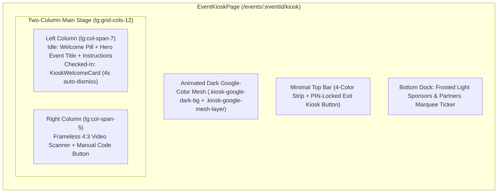

# KioskMode.md — Attendee Self-Check-In Kiosk Specification

> **Component**: [`src/pages/events/kiosk/EventKioskPage.tsx`](file:///Users/gab/Developer/apohub/src/pages/events/kiosk/EventKioskPage.tsx)  
> **Route**: `/events/:eventId/kiosk`  
> **Supporting Modules**: [`KioskWelcomeCard.tsx`](file:///Users/gab/Developer/apohub/src/pages/events/kiosk/KioskWelcomeCard.tsx), [`KioskManualCodeModal.tsx`](file:///Users/gab/Developer/apohub/src/pages/events/kiosk/KioskManualCodeModal.tsx), [`KioskPinModal.tsx`](file:///Users/gab/Developer/apohub/src/pages/events/kiosk/KioskPinModal.tsx), [`KioskSetupModal.tsx`](file:///Users/gab/Developer/apohub/src/components/KioskSetupModal.tsx), [`CameraService`](file:///Users/gab/Developer/apohub/src/services/cameraService.ts)

---

## 1. Purpose & Physical Scene

The **Attendee Self-Check-In Kiosk** transforms a stationary iPad, tablet, or laptop at an event registration desk into an unattended or semi-attended self-service badge scanner.

- **Physical Scene**: Attendees walk up to a podium or registration table in a dim auditorium lobby or bright tropical venue atrium, hold their phone or printed QR pass toward the camera, hear an immediate chime with celebratory visual confirmation, and walk in within 2 seconds.
- **Security Boundary**: Exiting Kiosk Mode back to the organizer workspace (`/events/:eventId/check-in`) is locked behind a 4-digit organizer PIN (`useKioskPin`) configured during station onboarding (`KioskSetupModal`).

---

## 2. Spatial & Visual Architecture

### 2.1 Animated Dark Mixed Google Colors Background
- **Base Class**: `.kiosk-google-dark-bg` (`#0b0f17` deep obsidian base layered with four corner radial gradients in Google Blue `#4285F4`, Google Red `#EA4335`, Google Yellow `#FBBC04`, and Google Green `#34A853`).
- **Animated Mesh Layer**: `.kiosk-google-mesh-layer` applies a blurred (`filter: blur(48px)`) four-color radial field animated via `@keyframes kiosk-google-mesh-drift` (`transform: translate3d(...) scale(...)` over `18s ease-in-out infinite`).
- **Performance & Accessibility**: Uses GPU-composited `transform` only (zero layout or paint thrashing across WebKit, Blink, and Gecko) and pauses automatically under `@media (prefers-reduced-motion: reduce)`.

### 2.2 Minimal Top Header
- Features the 4-color Google top accent strip (`h-1`) and a right-aligned, PIN-protected **Exit Kiosk** button (`min-h-control`).
- Intentionally omits the event initial logo icon, fullscreen toggle button, station badge, and live check-in counter pill to prevent visual clutter and protect venue privacy.

### 2.3 Two-Column Main Stage (`lg:grid-cols-12`)
1. **Left Column (`lg:col-span-7`) — Hero Greeting & Check-In Feedback**:
   - **Idle State**: Displays the `Welcome to` pill, a Hero-scale Event Title (`text-3xl sm:text-4xl lg:text-5xl font-extrabold text-inverse-on-surface tracking-tight leading-[1.12]`), clear check-in instructions, a 4-color accent divider, and inline error/warning alerts (`bannerFeedback`).
   - **Checked-In State (`welcomeData !== null`)**: Swaps in [`KioskWelcomeCard`](file:///Users/gab/Developer/apohub/src/pages/events/kiosk/KioskWelcomeCard.tsx) on a high-contrast light card surface (`bg-white text-on-surface`) with celebratory confetti, attendee name, organization, ticket tier badge, and a 4-second auto-reset progress bar.
2. **Right Column (`lg:col-span-5`) — Frameless Camera Scanner & Manual Entry**:
   - **Frameless Viewfinder**: A clean 4:3 rounded `<video>` container (`rounded-3xl overflow-hidden border border-white/20`) with no inner target box, corner reticles, or laser scanline overlay.
   - **QR Scan Processing Loader Overlay**: When a QR code is scanned and check-in is executing (`isCameraActive && isCheckingIn`), renders a translucent frosted overlay (`bg-inverse-surface/75 backdrop-blur-md`) inside the 4:3 camera viewfinder with a large `<LoadingSpinner size="lg" />` and `"Verifying QR Code..."` label, paired with a small inline `<LoadingSpinner size="sm" />` in the status caption below.
   - **Manual Code Fallback**: Full-width `Enter Code Manually` `<button>` (`min-h-control`) opening [`KioskManualCodeModal`](file:///Users/gab/Developer/apohub/src/pages/events/kiosk/KioskManualCodeModal.tsx) for attendees whose screen is cracked or who only have their registration ID, email, or GCash reference number.

### 2.4 Sponsors & Partners Bottom Ticker
- Rendered only when `event.sponsors && event.sponsors.length > 0`.
- Sits transparently over the animated dark Google-color background (no background fill or border box).
- Displays **logo images only** (no text labels or card boxes) conforming to each image's natural aspect ratio (`h-auto max-h-12 sm:max-h-14 w-auto object-contain`), scrolling seamlessly via `.animate-kiosk-ticker` (`translate3d(-50%, 0, 0)`).

---

## 3. Camera Hardware & Scanner Lifecycle

1. **Single-Owner Acquisition & Monotonic Epoch (`acquireEpochRef`)**:
   - Every `startCamera()` call increments `acquireEpochRef.current`. If a modal (`KioskSetupModal` or `KioskPinModal`) opens or the page unmounts while `getUserMedia` is negotiating, the superseded stream stops its tracks immediately upon resolution.
2. **OS Fallback Ladder (`CameraService.acquireKioskStream`)**:
   - Negotiates the organizer's chosen `deviceId`, falling back to `facingMode` (`'user'` or `'environment'`) and finally the OS default video input device.
3. **Hot-Plug & Disconnection Recovery**:
   - `wireTrackEnded` listens to `liveTrack.onended` (e.g., an external USB webcam is unplugged) and automatically falls back to the OS default camera.
   - `navigator.mediaDevices.addEventListener('devicechange', ...)` automatically retries camera acquisition when a camera is plugged in.
4. **Zero-Latency Welcome Card Handoff**:
   - When an attendee scans a valid QR code, `scanningRef.current` pauses while the underlying `MediaStream` (`streamRef.current`) **stays live**. Dismissing `KioskWelcomeCard` resumes `@zxing/browser` decoding immediately without re-acquiring hardware.

---

## 4. Authorization, Privacy & Idempotency Invariants

- **CASL Gate**: Verified on mount via `ability.can('checkin', asRegistration({ organizerUid: eventData.organizer?.uid }))`.
- **Scoped Roster Cache (DPA 2012)**: Fetches registrations strictly scoped to `eventId` via `RegistrationService.getEventRegistrations(eventId)`. Ref-mirrored in `registrationsRef` so long-lived scanner callbacks always read the freshest check-in state and reject duplicate scans.
- **Payment Verification Guard**: Blocks check-in with an audible warning buzz and inline alert if `reg.paymentStatus !== 'paid' && (reg.totalAmount ?? 0) > 0`.
- **Idempotent Write**: Calls `RegistrationService.checkInAttendee(reg.id, 'qr', true)` and updates the in-memory `registrations` state atomically.
