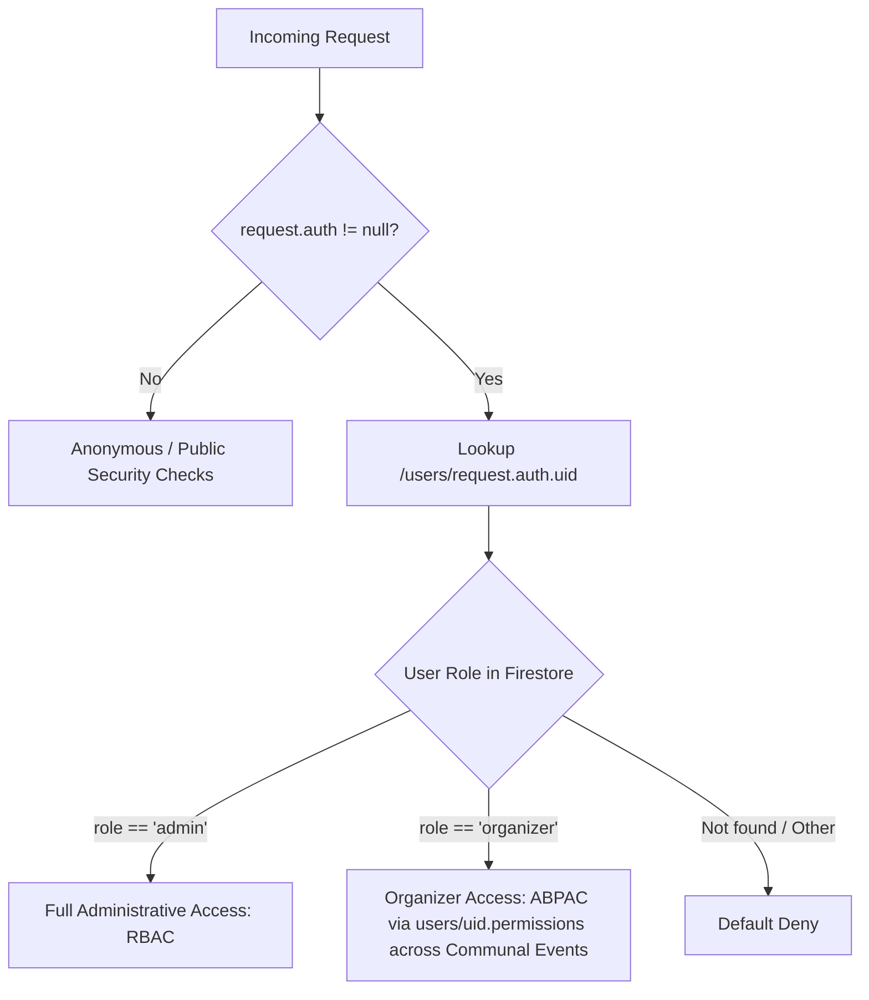

# TeamApo Hub Security Rules, Authorization & Code Style Standards

This document serves as the single source of truth for **TeamApo Hub**:
- **Part 1**: Security Rules & Authorization Architecture (Cloud Firestore, Cloud Storage, Cloud Functions)
- **Part 2**: Engineering Standards & Code Style Guidelines (TypeScript, React, Python, Tailwind CSS, Firestore, Git)

---

# PART 1: Security Rules & Authorization Architecture

## 1. Threat Model & Security Philosophy

TeamApo Hub is designed to solve a unique community event challenge: **minimize attendee friction** while **strictly securing event operations, financial data, and credentials**.

### Core Tenets:
1. **Frictionless Anonymous Attendance**: Attendees register without creating a Firebase Auth account. Public registration and payment operations must cross a trusted callable-function boundary; direct anonymous writes are not trusted for pricing, inventory, payment, or attendance state.
2. **Strict Field-Level Mutation Control**: When anonymous users perform permitted writes (e.g. reserving tickets or submitting feedback), security rules enforce atomic diff checks using `request.resource.data.diff(resource.data).affectedKeys().hasOnly([...])`.
3. **Role-Based Access Control (RBAC)**: Elevated privileges are restricted to verified Google Developer Group (GDG) organizers and platform administrators stored in the `/users/{userId}` collection.
4. **Data Immutability**: Historical audit logs (`activity_logs`) and attendee reviews (`feedback`) are immutable. Once written, they cannot be edited or tampered with.
5. **Private Token Intermediaries**: Sensitive operations (e.g., feedback completion links) utilize server-managed tokens in `/feedbackTokens/{tokenId}` that are completely unreachable by client SDKs.

---

## 2. Authorization Hierarchy & Helper Functions

Security rules use reusable, centralized helper functions defined at the root of `firestore.rules` and `storage.rules`:



### 2.0 Hybrid RBAC + ABPAC Architecture & Client-Side CASL Alignment

TeamApo Hub implements a **Hybrid RBAC (Role-Based Access Control) + ABPAC (Attribute-Based Policy Access Control)** authorization architecture with a **Communal Event Model**:
1. **Unrestricted Admin (RBAC)**: The `admin` role maintains full platform-wide access across all collections, subcollections, routes, and cloud functions.
2. **Communal Events & Granular Organizer Capabilities (ABPAC)**: Events are community assets without individual creator ownership. Organizers operate under fine-grained domain permissions stored in `users/{userId}.permissions` (`events`, `attendees`, `checkin`, `payments`, `certificates`, `feedback`) that govern functional actions across all events.
3. **Resource Lifecycle Constraints (ABAC)**: Completed or cancelled events (`status in ['completed', 'cancelled']`) are frozen from updates and subcollection modifications for non-administrators.
4. **Destructive Action Hardening**: Event deletion is reserved exclusively for platform administrators (`allow delete: if isAdmin()`). Organizers cannot delete events; they can archive or cancel events via `events.canUpdate`.
5. **Dual-Layer Synchronization**: `src/auth/ability.ts` builds a CASL ability from the signed-in user's profile and permissions, and `RequireAbility` uses it to decide what to render. **`firestore.rules` is the authoritative security boundary; CASL is the client-side UX alignment layer.** Whenever a rule clause changes, the matching ability rule must change with it.

The table below defines the strict 1:1 contract between CASL and `firestore.rules`:

| CASL rule | Mirrors |
| :--- | :--- |
| absent — no profile, `isActive !== true`, or an unrecognised role | `isAdmin()` / `isOrganizer()` requiring `isActive == true`. Fail-closed at every branch. |
| `read` on `Event`, `Registration`, `Certificate`, `PaymentProof`, `Feedback` (unconditioned) | Reaching the workspace at all. Area access gated by granular functional permissions (`attendees.canRead`, `certificates.canManage`, `payments.canVerify`, `feedback.canRead`). |
| `read 'all'` | `allow list: if isAdmin()` and the admin-only user administration routes. |
| `update Event` on active lifecycle | `isOrganizer() && hasPerm('events', 'canUpdate') && !(resource.data.status in ['completed', 'cancelled'])`. Completed/cancelled events are frozen from organizer edits. Communal: no creator ownership. |
| `delete Event` | **Admin only.** `allow delete: if isAdmin()`. Organizers cannot delete events under any circumstances. |
| `create Event` | `allow create: if isAdmin() \|\| (isOrganizer() && hasPerm('events', 'canCreate'))`. No creator ownership field written. |
| `update` on `Registration` | `isOrganizer() && hasPerm('attendees', 'canUpdate')`. Communal access across events. |
| `delete` on `Registration` | `isOrganizer() && hasPerm('attendees', 'canDelete')`. Communal access across events. |
| `export` on `Registration` | UI gating on `attendees.canExport !== false` for attendee CSV and email log downloads. |
| `checkin` on `Registration` | `attendees.canUpdate !== false && checkin.canCheckIn !== false` for QR scanning and manual check-ins across events. |
| `update` on `Certificate` | `isOrganizer() && hasPerm('certificates', 'canManage')`. Communal access. |
| `update`/`delete` on `PaymentProof` | `isOrganizer() && hasPerm('payments', 'canVerify')`. Communal access. |
| `read`/`create User`, `update User` where `uid != me` | `match /users/{userId}` |
| `delete User` where `uid != me` and `role != 'admin'` | **Rules now close it entirely:** `allow delete: if false` on `/users/{userId}`. Deletion is a two-halves operation (Firebase Auth identity + profile document) and happens only through the `deleteUser` Admin SDK callable, which enforces the self-delete, superuser, and last-admin guards and writes the audit entry. |
| `functions/main.py` `require_elevated` / `require_admin` | `isAdmin() \|\| (isOrganizer() && isActive == true)` |

Three CASL behaviours the ability depends on, all pinned by
`tests/unit/ability.test.ts`:

1. **There is no negation.** A rule whose conditions fail does not *deny*, it
   simply does not match, and evaluation continues to the next rule. A
   conditional rule can narrow a subject, never a broader grant of that same
   subject. Admins are therefore granted `read 'all'` plus an explicit
   per-subject `manage` list, never a blanket `manage 'all'` — a blanket grant
   would silently void "never delete yourself, never delete another admin".
2. **Conditions are ignored, not failed, on a subject type.** `can('manage',
   'Event')` answers true for an organizer despite the ownership condition, so a
   conditional verb can never be a route gate.
3. **Plain objects carry no subject.** CASL reads the constructor name, which
   for an object literal is `"Object"`, so every entity check goes through the
   `asEvent` / `asUser` / … helpers. They are explicit functions rather than an
   automatic resolver because sniffing a subject out of field names would make a
   mis-typed entity silently match the wrong rule.

### 2.1 Firestore Helper Functions

```javascript
// Validates presence of an active Firebase Auth token
function isAuthenticated() {
  return request.auth != null;
}

// Enforces document ownership by matching Auth UID to document ID
function isOwner(uid) {
  return request.auth != null && request.auth.uid == uid;
}

// Checks if authenticated user has role == 'admin' in Firestore
function isAdmin() {
  return request.auth != null && 
         exists(/databases/$(database)/documents/users/$(request.auth.uid)) &&
         get(/databases/$(database)/documents/users/$(request.auth.uid)).data.role == 'admin';
}

// Checks if authenticated user is either 'organizer' or 'admin'
function isOrganizer() {
  return request.auth != null && 
         exists(/databases/$(database)/documents/users/$(request.auth.uid)) &&
         (get(/databases/$(database)/documents/users/$(request.auth.uid)).data.role == 'organizer' || 
          get(/databases/$(database)/documents/users/$(request.auth.uid)).data.role == 'admin');
}

// Syntactic sugar combining admin and organizer checks
function isAdminOrOrganizer() {
  return request.auth != null &&
         exists(/databases/$(database)/documents/users/$(request.auth.uid)) &&
         (get(/databases/$(database)/documents/users/$(request.auth.uid)).data.role == 'admin' ||
          get(/databases/$(database)/documents/users/$(request.auth.uid)).data.role == 'organizer');
}

// Regex format validator for email integrity
function isValidEmail(email) {
  return email is string && email.matches('.*@.*[.].*');
}
```

### 2.2 Storage Helper Functions

```javascript
// Max 5MB size limit for image uploads
function isValidImageSize() {
  return (request.resource != null ? request.resource.size : resource.size) < 5 * 1024 * 1024;
}

// Enforces MIME type matching image/*
function isValidImageType() {
  let ct = (request.resource != null ? request.resource.contentType : resource.contentType);
  return ct != null && ct.matches('image/.*');
}

// Enforces approved document MIME types (PDF, JPEG, PNG)
function isValidDocumentType() {
  let ct = (request.resource != null ? request.resource.contentType : resource.contentType);
  return ct != null && (ct in ['application/pdf', 'image/jpeg', 'image/png']);
}
```

---

## 3. Firestore Rules Matrix & Deep Dive

| Collection Path | Read | List | Create | Update | Delete | Key Security Constraints |
| :--- | :---: | :---: | :---: | :---: | :---: | :--- |
| `/users/{userId}` | Owner / Admin | Admin | Admin | Owner / Admin | **Denied (callable-only)** | Email syntax validated; Role restricted to `admin` or `organizer`. Privilege escalation blocked. Client deletes denied: deletion is the `deleteUser` Admin SDK callable's two-halves operation (Auth + doc) with audit, so a document-only orphan is impossible. |
| `/events/{eventId}` | Public (Published) / Organizer / Admin | Public (Published) / Organizer / Admin | Organizer / Admin | Organizer / Admin | Admin | Enforces `hasNoPublicPromoCodes(request.resource.data)` so secret promo codes cannot be written to public event documents (`hasPromoCodes: boolean` is used instead). |
| `/events/{id}/forms/{formId}` | Public (Published) / Organizer / Admin | Public (Published) / Organizer / Admin | Organizer / Admin | Organizer / Admin | Organizer / Admin | Read allowed when parent event is published or caller can manage event. |
| `/events/{id}/config/{configId}` | Organizer / Admin | Organizer / Admin | Organizer / Admin | Organizer / Admin | Organizer / Admin | Protected configuration settings, including `config/promoCodes` (`{ promoCodes: PromoCode[] }`). |
| `/promocodes/{codeId}` | **Denied** | **Denied** | **Denied** | **Denied** | **Denied** | **100% Locked**. Zero direct client access; promo code validation runs exclusively via the `validatePromoCode` and `createAnonymousRegistration` Cloud Functions. |
| `/registrations/{regId}` | Organizer / Admin | Organizer / Admin / Trusted Function | Organizer / Admin (Trusted Function for Anonymous) | Organizer / Admin / Trusted Function | Admin / Organizer | Payment-link reads and anonymous state transitions must use callable functions; direct unauthenticated client creates/reads/writes are denied. |
| `/certificateTemplates/{id}` | Public | Public | Organizer / Admin | Organizer / Admin | Organizer / Admin | Public read enables client-side certificate dynamic preview and rendering. |
| `/certificates/{certId}` | Public | Public | Public / Function | Restricted Anonymous / Auth | Authenticated | Anonymous create requires `eventId`, `registrationId`, `verificationCode`, and `recipientName`. Anonymous update strictly restricted to incrementing `verificationCount`. |
| `/feedbackTokens/{tokenId}` | **Denied** | **Denied** | **Denied** | **Denied** | **Denied** | **100% Locked**. Only Cloud Functions with Firebase Admin SDK can read/write tokens. Prevents attendee enumeration. |
| `/feedback/{feedbackId}` | Authenticated | Authenticated | Public (Anonymous) | **Denied** | Authenticated | Valid email required. Target `eventId` must be a string. **Updates are disallowed** (immutable). |
| `/activity_logs/{logId}` | Authenticated | Authenticated | Authenticated | **Denied** | Authenticated | Immutable audit trail. |
| `/event_analytics/{id}` | Authenticated | Authenticated | Authenticated | Authenticated | Authenticated | Admin/organizer analytics rollups. |
| `/paymentProofs/{proofId}` | Event Admin / Organizer | Event Admin / Organizer | Admin / Organizer / Trusted Function | Event Admin / Organizer | Event Admin / Organizer | Direct anonymous reads and creates are denied; proof submission must use a trusted function. |
| `/system/{docId}` | Authenticated | Authenticated | Authenticated | Authenticated | Authenticated | Platform-wide operational configs. |
| `/{document=**}` | **Denied** | **Denied** | **Denied** | **Denied** | **Denied** | Catch-all default deny. |

---

## 4. Key Attack Vectors & Mitigations

### 4.1 Mass Assignment & Field Tampering
* **Threat**: A malicious attendee intercepts the registration request and attempts to set `totalAmount = 0`, `paymentStatus = 'paid'`, or `attendanceStatus = 'checked-in'`.
* **Mitigation**: 
   1. Unauthenticated client `create` operations on `/registrations` are completely denied in `firestore.rules`.
   2. All anonymous registrations must pass through the `createAnonymousRegistration` callable Cloud Function, which runs an atomic Firestore transaction to verify published status, check ticket inventory, calculate official ticket pricing, prevent duplicate email registrations, and initialize tickets with `paymentStatus: 'pending'` and `attendanceStatus: 'pending'`.
   3. Direct client updates cannot mark registrations as `paid` or `checked-in`. Check-ins, payment verification, and attendee management are restricted strictly to authenticated event organizers and administrators.

### 4.2 Ticket Inventory & Promo Code Isolation (`VULN-01` & `VULN-02`)
* **Threat**:
  1. An unauthenticated attendee inspects browser DevTools Network tab (`Listen/channel` or REST payload) on `/e/:slug` to harvest all active promo codes, expiration dates, and usage limits from the event document.
  2. An anonymous registrant tampers with event properties or client-side discount calculations.
* **Mitigation**:
  1. Promo code arrays are isolated inside `/events/{eventId}/config/promoCodes` (`allow read: if canManageEvent(eventId)`), and `/events/{eventId}` enforces `hasNoPublicPromoCodes(request.resource.data)` on create/update while exposing only `hasPromoCodes: boolean`. Direct client access to `/promocodes/{codeId}` is also denied (`allow read, write: if false`).
  2. Attendees validate codes via the `validatePromoCode` HTTPS Callable Cloud Function, which returns only `{ valid, code, discountType, discountValue, maxDiscountAmount, discountAmount, finalPrice }`.
  3. Authoritative promo code validation, discount computation, and `currentUses` increment execute atomically inside the `createAnonymousRegistration` Admin SDK transaction.

### 4.3 Feedback Token Enumeration & PII Leakage
* **Threat**: An attacker queries `/feedbackTokens` or attempts to guess URLs to discover attendee identities or emails.
* **Mitigation**:
  ```javascript
  match /feedbackTokens/{tokenId} {
    allow read: if false;
    allow write: if false;
  }
  ```
  The collection is inaccessible via client SDKs. Client requests must submit the token to the `resolveFeedbackToken` callable Cloud Function, which runs server-side validation and decrypts the attendee details.

### 4.4 Privilege Escalation on User Accounts
* **Threat**: A standard user updates their document in `/users` to grant themselves `role: 'admin'`.
* **Mitigation**:
  ```javascript
  match /users/{userId} {
    allow create: if isAuthenticated() && isAdmin() &&
                     isValidEmail(resource.data.email) &&
                     resource.data.role in ['admin', 'organizer'];
    allow update: if isAuthenticated() && (isAdmin() || isOwner(userId));
    // Two-halves deletion: a document-only delete leaves the Auth account alive.
    allow delete: if false;
  }
  ```
  Non-admin users cannot create accounts or promote accounts to admin. Organizers cannot change their assigned roles. No client — not even an admin — can delete a user document: the only removal path is the `deleteUser` Admin SDK callable.

* **Known gap — the superuser tier is enforced twice, and only once server-side.**
  `AdminUsersPage` lets one administrator (identified by `VITE_SUPERUSER_EMAIL`,
  baked into the browser bundle at build time) delete other administrators'
  accounts, and hides the button for everyone else. That was the entire
  enforcement: `firestore.rules` used to say `allow delete: if isAdmin()`, with no
  "not another admin" clause and no superuser concept, so the disabled button was
  the only thing standing between an admin and a peer's account.
  The rule now lives in two places that must agree:
  - **Client** — the ability's `delete User` condition, which only decides what
    the UI offers. Readable by anyone with devtools.
  - **Server** — the `deleteUser` callable, which reads `SUPERUSER_EMAIL` from
    its own environment and refuses otherwise, also guarding the last remaining
    active administrator and accounts that still own active events
    (draft/published/ongoing) whose `organizer.uid` is immutable. This is the
    half that holds.

  Deletion goes through that callable — now exclusively, since rules deny all
  direct client deletes — because removing the `users` document alone leaves the
  Firebase Auth account alive, and an orphaned account can still sign in. The
  callable removes both halves (Auth identity first, then the document), cleans
  up the account's `profilePictures/{uid}/` Cloud Storage files as best-effort
  PII retention cleanup (Philippines DPA 2012), and lands the single audit
  entry. `SUPERUSER_EMAIL` is currently absent from `functions/.env.example`
  (the `.env.*` glob in `.gitignore` excludes it), so a deployment without it
  has no superuser tier at all and `deleteUser` will refuse to remove any
  administrator.

---

## 5. Cloud Storage Security Rules Breakdown

Storage rules ensure media, payment receipts, and generated certificates are safely isolated.

### 5.1 Event Images & Assets
```javascript
match /events/{eventId}/images/{imageId} {
  allow read: if true; // Public event posters
  allow write: if isOrganizer() && isValidImageSize() && isValidImageType();
  allow delete: if isAdmin() || (isAuthenticated() && firestore.get(/databases/(default)/documents/events/$(eventId)).data.organizer.uid == request.auth.uid);
}
```
* **Read**: Public worldwide.
* **Write**: Authenticated organizers only; max 5MB; image MIME type required.
* **Delete**: Event owner or platform admin only.

### 5.2 Payment Proofs Upload
```javascript
match /payment-proofs/{registrationId}/{proofId} {
  allow read: if isAdminOrOrganizerForRegistration(registrationId);
  allow create: if isAdminOrOrganizerForRegistration(registrationId) &&
                isValidImageType() &&
                request.resource.size < 5 * 1024 * 1024;
  allow update, delete: if isAdmin();
}
```
* **Trusted Upload**: Direct anonymous uploads are denied. A callable function must validate the payment-link token before accepting a proof.
* **Size Enforcement**: Limited to 5MB.
* **Safari Fallback**: Safari occasionally omits `contentType` when uploading images. The rule features a fallback regex checking the extension of the `proofId` for `.jpg`, `.jpeg`, `.png`, `.heic`, etc.

### 5.3 Certificate Storage & Generation
```javascript
match /certificates/{eventId}/{filename} {
  allow read: if true; // Public verification access
  allow write: if true; // Anonymous write for client-rendered certificates post-feedback
  allow delete: if isAdmin();
}
```
* Certificates are publicly readable to support the digital verification portal.
* Client-side generation (via jsPDF / html2canvas) or serverless triggers can store rendered PDF certificates. Deletions are restricted to administrators.

---

## 6. Cloud Functions Security & Region Consistency

The TeamApo Hub backend comprises Python 2nd Gen Cloud Functions hosted in Google Cloud Run.

### 6.1 Regional Isolation (`asia-southeast2`)
To prevent preflight failures, CORS errors, and cross-region latency, both the client SDK and functions runtime are pinned to `asia-southeast2` (Jakarta):
* **Backend (`functions/main.py`)**:
  ```python
  from firebase_functions.options import set_global_options
  set_global_options(region="asia-southeast2", max_instances=10)
  ```
* **Frontend (`src/config/firebase.ts`)**:
  ```typescript
  export const functions = getFunctions(app, 'asia-southeast2');
  ```

### 6.2 Callable Request Context Verification
Protected Cloud Functions strictly verify the user's authentication context and Firestore role:
```python
def checkInAttendee(req: https_fn.CallableRequest) -> Dict[str, Any]:
    if not req.auth:
        raise https_fn.HttpsError(
            https_fn.FunctionsErrorCode.UNAUTHENTICATED,
            "Must be authenticated to perform check-in."
        )
    
    caller_uid = req.auth.uid
    db = get_db()
    user_doc = db.collection('users').document(caller_uid).get()
    
    if not user_doc.exists or user_doc.to_dict().get('role') not in ['admin', 'organizer']:
        raise https_fn.HttpsError(
            https_fn.FunctionsErrorCode.PERMISSION_DENIED,
            "Only organizers and administrators can check in attendees."
        )
```

### 6.3 Environment Variables & Secrets Handling
Sensitive third-party credentials are kept outside client bundles and git history:
* `RESEND_API_KEY`: Kept on server runtime for transactional email dispatch.

---

## 7. Security Audit & Deployment Checklist

Before deploying rule updates to production, execute the following validation cycle:

```bash
# 1. Validate security rules syntax
bun run firebase:rules:validate

# 2. Deploy Firestore & Storage rules
bun run firebase:rules

# 3. Verify indexes are synchronized
bun run firebase:indexes

# 4. Check active rules status
bun run firebase:rules:status
```

---

# PART 2: Engineering Standards & Code Style Guidelines

## 8. TypeScript Coding Standards

### 8.1 Strict Typing & Safety
* **No `any`**: Avoid the `any` keyword. Use explicit types, generics, or `unknown` with type narrowing.
* **Interface vs. Type**: Prefer `interface` for object models, component props, and service contracts. Use `type` for unions, primitives, and complex computed types.
* **Explicit Return Types**: All exported functions, service methods, and custom hooks must declare explicit return types.

```typescript
// ✅ Good: Clear contract with explicit types
export interface EventRosterProps {
  eventId: string;
  onAttendeeSelect: (registration: Registration) => void;
  filterStatus?: AttendanceStatus;
}

export const formatAttendeeName = (details: Registration['userDetails']): string => {
  return details.name.trim();
};

// ❌ Bad: Implicit any and missing return type
export const getDetails = (details: any) => {
  return details.name;
};
```

### 8.2 Enums and Union Types
Use string literal union types over TypeScript numeric `enum`s to ensure seamless JSON serialization with Firestore documents:

```typescript
// ✅ Good: Direct string representation in Firestore
export type EventStatus = 
  | 'draft' 
  | 'published' 
  | 'ongoing' 
  | 'completed' 
  | 'cancelled' 
  | 'postponed';

export type PaymentStatus = 
  | 'pending' 
  | 'processing' 
  | 'paid' 
  | 'failed' 
  | 'refunded' 
  | 'cancelled';
```

### 8.3 Immutability
Do not mutate state, props, or query results directly. Use object spread, array methods (`map`, `filter`), or functional updates:

```typescript
// ✅ Good: Immutable copy with updated property
const updatedTicketTypes = event.ticketTypes.map(ticket => 
  ticket.id === targetId ? { ...ticket, currentSold: ticket.currentSold + 1 } : ticket
);

// ❌ Bad: Direct array mutation
event.ticketTypes[0].currentSold += 1;
```

---

## 9. React Component Architecture

### 9.1 Functional Components & Props
All components must be functional components with typed props. Use destructuring with sensible defaults.

**Do not re-declare a shared primitive's API in docs.** Props interfaces in this file were
historically illustrative and drifted from the real components, which cost readers a
misleading example. Refer to the component file for its actual props and use the shared
`Button` rather than reimplementing it.

The current `Button` contract (`src/components/UI/Button.tsx`) is:

| Prop | Type | Notes |
|---|---|---|
| `variant` | `'filled' \| 'tonal' \| 'outlined' \| 'text' \| 'elevated' \| 'danger'` | Defaults to `'filled'`. `'danger'` is not a Material variant; it exists because irreversible actions must not look like `filled` |
| `size` | `'sm' \| 'md' \| 'lg'` | Defaults to `'md'`. **Every size is 48px tall**; only horizontal padding and type size change |
| `loading` | `boolean` | Disables the button, sets `aria-busy`, swaps the label for a spinner in the same grid cell |
| `icon` | `ReactNode` | Decorative leading icon. `aria-hidden` |
| `iconTrailing` | `ReactNode` | Decorative trailing icon. `aria-hidden` |
| `fullWidth` | `boolean` | Adds `w-full` |

Note the names: `loading`, not `isLoading`; `icon` / `iconTrailing`, not `leftIcon`. The
component also defaults `type` to `'button'` and forwards a ref.

```typescript
// Correct usage of the shared primitive.
<Button variant="filled" loading={isSaving} icon={<PlusIcon />}>
  Create event
</Button>

// Wrong: these props do not exist on the shared Button. Use it instead.
<Button variant="primary" isLoading leftIcon={<PlusIcon />} />
```

See [DESIGN_SYSTEM.md](DESIGN_SYSTEM.md) for the geometry and state-layer rules the primitive enforces.

### 9.2 Hook Ordering & Conventions
Group component logic cleanly in standard order:
1. **React State Hooks** (`useState`, `useReducer`)
2. **Context & External State Hooks** (`useAuth`, `useNavigate`, `useParams`)
3. **Ref Hooks** (`useRef`)
4. **Side Effect Hooks** (`useEffect`, `useLayoutEffect`)
5. **Memoized Values & Callbacks** (`useMemo`, `useCallback`)
6. **Custom Event Handlers** (`handle...`)
7. **Early Return Guards** (Loading, error, empty state)
8. **Render JSX**

```typescript
export const AttendeeCheckInCard: React.FC<{ registrationId: string }> = ({ registrationId }) => {
  // 1. State
  const [isProcessing, setIsProcessing] = useState<boolean>(false);
  const [error, setError] = useState<string | null>(null);

  // 2. Context & Router
  const { userProfile } = useAuth();
  const navigate = useNavigate();

  // 3. Effects
  useEffect(() => {
    setError(null);
  }, [registrationId]);

  // 4. Handlers
  const handleCheckIn = async (): Promise<void> => {
    try {
      setIsProcessing(true);
      await RegistrationService.checkIn(registrationId);
      toast.success('Attendee checked in!');
    } catch (err: unknown) {
      const msg = err instanceof Error ? err.message : 'Check-in failed';
      setError(msg);
      toast.error(msg);
    } finally {
      setIsProcessing(false);
    }
  };

  // 5. Render
  return (
    <div className="p-4 bg-white rounded-xl shadow-sm border border-gray-100">
      {/* Component markup */}
    </div>
  );
};
```

### 9.3 Separation of Concerns: Service Layer
**Components must not contain direct Firestore or API calls.** All data fetching, business logic, and backend coordination must reside in `src/services/`.

* Components: Render UI, capture user interactions, display state.
* Services: Query Firestore, run transactions, execute callable functions, handle schema transformations.

---

## 10. Styling & Design System Rules (Tailwind CSS)

### 10.1 Colour Role Guidelines

**Do not reference brand names in component code.** Reference the role a colour plays. The
authoritative definitions, derivations, and contrast ratios live in
[DESIGN.md section 2](../DESIGN.md#2-colors); spacing, control geometry, state layer,
motion, and browser floor live in [DESIGN_SYSTEM.md](DESIGN_SYSTEM.md).

The Google brand hexes are **not** the fills. Each one fails WCAG AA against white text at
16px, and every button label in this product is 16px:

| Brand hex | With white text | Verdict |
| --- | --- | --- |
| `#4285f4` | 3.56:1 | Fails AA |
| `#ea4335` | 3.92:1 | Fails AA |
| `#34a853` | 3.06:1 | Fails AA |
| `#fbbc04` | 1.71:1 | Fails badly |

Fills use tone 40 of each ramp instead. `bg-blue-600` (`#1a73e8`) is not a token in this
system and does not clear AA either.

Use these role tokens:

| Role | Fill | On-fill | Use for |
|---|---|---|---|
| Primary | `bg-primary` (`#0b57d0`, 6.39:1) | `text-on-primary` | Primary actions, active navigation, links, focus rings |
| Error | `bg-error` (`#b3261e`, 6.54:1) | `text-on-error` | Rejections, destructive actions |
| Success | `bg-success` (`#186a3b`, 6.64:1) | `text-on-success` | Confirmed tickets, valid certificates |
| Warning | container pair `bg-warning-container` (`#fce8b2`) | `text-on-warning-container` (`#3d2700`, 11.64:1) | Pending payments, review alerts |
| Surface | `bg-surface` (`#fbfcfd`) | `text-on-surface` (`#191c20`) | Page ground, cards |
| Nested surface | `bg-surface-container-low` to `bg-surface-container-highest` | `text-on-surface` | Nested groupings, one tone at a time |
| Metadata | | `text-on-surface-variant` (`#4a5157`, 7.85:1) | Helper copy, timestamps |
| State border | | `border-outline` (`#747b82`, 4.17:1) | Borders carrying state, focus rings |
| Decorative hairline | | `border-outline-variant` (`#c4c9cf`) | Dividers only. Never a boundary whose absence changes meaning |

`tests/unit/designTokens.test.ts` asserts every ratio in that table against
`tailwind.config.js`, so a token edit that breaks contrast fails the build.

The legacy tonal ramps (`gray-*`, `blue-*`, `red-*`, `green-*`) still exist for the
in-progress codemod. **New code must not reach for them.**

### 10.2 Class Grouping Order
Follow a consistent ordering pattern for Tailwind utility classes, using role tokens:
1. **Layout & Positioning**: `relative`, `absolute`, `flex`, `grid`, `items-center`, `justify-between`
2. **Box Model**: `w-full`, `max-w-lg`, `p-4`, `gap-md`, `min-h-control`, `px-control-x`
3. **Typography**: `text-sm`, `font-medium`, `text-on-surface`, `leading-tight`
4. **Visuals & Backgrounds**: `bg-surface`, `border`, `border-outline-variant`, `rounded-xl`, `shadow-elevation-1`
5. **Interactive & Pseudo-classes**: `md-state-layer`, `focus-visible:ring-2`, `disabled:opacity-38`, `transition-colors`

Prefer `gap-*` on a flex or grid parent over margins on the children: see
[DESIGN_SYSTEM.md section 2.4](DESIGN_SYSTEM.md#24-gap-over-margins).

**Never hand-roll hover or active states.** Add the `md-state-layer` class and let the
state layer in `src/index.css` do it. Variant-specific `hover:bg-*` strings are only
allowed inside `src/components/UI/`, which `tests/unit/designSystem.test.ts`
enforces.

### 10.3 Mobile-First Responsiveness
Always design for mobile viewports first, then enhance for desktop using responsive prefixes:
```tsx
// ✅ Mobile-first: single column by default, 2 cols on tablet, 3 cols on desktop
<div className="grid grid-cols-1 sm:grid-cols-2 lg:grid-cols-3 gap-6">
```

---

## 11. Python Backend Standards (Cloud Functions)

### 11.1 Code Style & PEP 8
* **Indentation**: 4 spaces (no tabs).
* **Naming**: `snake_case` for functions, methods, and variables; `PascalCase` for classes and exceptions; `UPPER_SNAKE_CASE` for module constants.
* **Type Hinting**: All function parameters and return types must include typing annotations:
  ```python
  from typing import Dict, List, Any, Optional
  from firebase_functions import https_fn

  def validate_ticket_order(
      order_items: List[Dict[str, Any]], 
      event_id: str
  ) -> Dict[str, Any]:
      ...
  ```

### 11.2 Error Handling & HTTP Status Codes
Always raise `https_fn.HttpsError` with the appropriate `FunctionsErrorCode` rather than throwing generic Python exceptions:

```python
# ✅ Good: Explicit HttpsError with actionable message
if not registration_doc.exists:
    raise https_fn.HttpsError(
        https_fn.FunctionsErrorCode.NOT_FOUND,
        f"Registration with ID '{registration_id}' was not found."
    )

if ticket["currentSold"] + requested_qty > ticket["maxQuantity"]:
    raise https_fn.HttpsError(
        https_fn.FunctionsErrorCode.RESOURCE_EXHAUSTED,
        "Selected ticket tier is sold out."
    )
```

### 11.3 Firestore Client Initialization
Always use the lazy initialization singleton via `get_db()`:
```python
_db = None

def get_db():
    global _db
    if _db is None:
        _db = firestore.client()
    return _db
```

---

## 12. Database Access & Mutation Standards

### 12.1 Atomic Transactions for Shared Counters
Any operation that adjusts ticket sales count (`currentSold`), overall attendees (`currentAttendees`), or promo code redemptions (`currentUses`) **must use `runTransaction`** to prevent race conditions:

```typescript
await runTransaction(db, async transaction => {
  const eventDoc = await transaction.get(eventRef);
  if (!eventDoc.exists()) {
    throw new Error('Event not found');
  }

  const eventData = eventDoc.data() as Event;
  const targetTicket = eventData.ticketTypes.find(t => t.id === ticketTypeId);
  
  if (!targetTicket) {
    throw new Error('Ticket type not found');
  }

  if (targetTicket.maxQuantity && targetTicket.currentSold + quantity > targetTicket.maxQuantity) {
    throw new Error('Tickets are sold out');
  }

  targetTicket.currentSold += quantity;
  transaction.update(eventRef, {
    ticketTypes: eventData.ticketTypes,
    currentAttendees: increment(quantity),
    updatedAt: serverTimestamp()
  });
});
```

### 12.2 Timestamp Invariant
Never use client-generated timestamps (`new Date()`) for Firestore document creation or audit fields. Always use `serverTimestamp()`:
```typescript
// ✅ Good: Reliable server timestamp
createdAt: serverTimestamp(),
updatedAt: serverTimestamp()

// ❌ Bad: Clock skew risk
createdAt: new Date()
```

### 12.3 Query Limits
Every Firestore query against unbounded collections (`registrations`, `feedback`, `activity_logs`) **must specify a `limit()`** to prevent unbounded billing spikes:
```typescript
const q = query(
  collection(db, 'registrations'),
  where('eventId', '==', eventId),
  orderBy('registrationDate', 'desc'),
  limit(50) // Enforce pagination
);
```

---

## 13. Logging, Error Handling & User Feedback

### 13.1 Development vs. Production Logging
Do not use raw `console.log()` in frontend application code. Use the centralized `logger` utility (`src/utils/logger.ts`), which automatically mutes all output in production builds:

```typescript
import { logger } from '@/utils/logger';

// ✅ Output only appears when import.meta.env.DEV is true
logger.log('Processing payment link token:', token);
logger.warn('Token nearing expiration:', expiresAt);
logger.error('Payment verification failed:', error);
```

### 13.2 Toast Notifications UX & Design System
Centralized notifications use `react-hot-toast` rendered through `<AppToaster />` from `@/components/UI`. Never create ad-hoc notification elements.

- **Placement & Responsiveness**: Top-center with safe-area padding on mobile viewports (< 640px) with clearance for device notches; top-right on desktop (≥ 640px).
- **Surface Styling**: Semantic Material 3 role tokens (`success-container`, `error-container`, `secondary-container`, `surface-container-high`). NO colored side-stripe borders (strictly banned).
- **Dismiss & Interaction**: Interactive tap-to-dismiss plus dedicated close button (`min-h-control min-w-control`, 48px target). 4s timeout for success/info, 6s for errors to ensure readability.
- **Copy Guidance**:
  - `toast.success('Action completed.')`: Past-tense completions. One sentence. No emojis, no exclamation marks.
  - `toast.error('Failed action. Recovery advice.')`: Actionable failures ending with next step.
  - `toast.loading('Processing...')`: Active gerund operations.
  - `toast('Informational notice.')`: Informational neutral notices (automatically styled with M3 secondary container and SVG info icon).

---

## 14. File Organization & Naming Conventions

| Category | Convention | Example |
| :--- | :--- | :--- |
| **React Components** | `PascalCase.tsx` | `EventCard.tsx`, `AdminLayout.tsx` |
| **Page Components** | `PascalCase.tsx` with `Page` suffix | `AdminDashboardPage.tsx`, `AttendeesPage.tsx` |
| **Custom Hooks** | `camelCase.ts` with `use` prefix | `usePageTitle.ts`, `useDebounce.ts` |
| **Service Modules** | `camelCase.ts` with `Service` suffix | `registrationService.ts`, `emailService.ts` |
| **Utility Functions** | `camelCase.ts` | `formatDate.ts`, `logger.ts` |
| **Global Constants** | `UPPER_SNAKE_CASE.ts` | `API_CONSTANTS.ts`, `DEFAULT_THEME.ts` |
| **Python Cloud Functions** | `snake_case.py` | `main.py`, `email_service.py` |

### 14.1 Import Grouping
Organize imports into discrete, alphabetically sorted blocks separated by an empty line:

```typescript
// 1. React and third-party libraries
import React, { useState, useEffect } from 'react';
import { useNavigate, useParams } from 'react-router-dom';
import { toast } from 'react-hot-toast';

// 2. Firebase SDKs
import { doc, getDoc } from 'firebase/firestore';
import { db } from '@/config/firebase';

// 3. Application Services & Utilities
import { EventService } from '@/services/eventService';
import { logger } from '@/utils/logger';

// 4. UI Components — from the barrel, never by file path
import { Button, LoadingSpinner } from '@/components/UI';

// 5. Types and Interfaces
import type { Event, TicketType } from '@/types';
```

---

## 15. Git & Pull Request Guidelines

### 15.1 Conventional Commit Messages
All commit messages must adhere to the [Conventional Commits](https://www.conventionalcommits.org/) specification:

* `feat(scope)`: A new feature (e.g. `feat(checkin): add camera flashlight toggle`)
* `fix(scope)`: A bug fix (e.g. `fix(tickets): resolve concurrency counter race condition`)
* `docs(scope)`: Documentation changes (e.g. `docs(rules): document code style guidelines`)
* `style(scope)`: Code formatting, whitespace, semicolons (no code change)
* `refactor(scope)`: Code refactoring without changing behavior
* `perf(scope)`: Performance optimizations
* `test(scope)`: Adding or correcting tests
* `chore(scope)`: Build tools, package dependencies, configs

### 15.2 Branch Naming Conventions
```bash
feature/ticket-tier-pricing
fix/payment-proof-upload-safari
docs/update-architecture-spec
refactor/cloud-function-email-loader
```

### 15.3 Pull Request Quality Checklist
Before requesting a code review:
- [ ] Code passes linter without errors (`bun run lint`).
- [ ] TypeScript types compile without errors (`bun run build`).
- [ ] No raw `console.log()` calls added (use `logger` instead).
- [ ] Security rules validated (`bun run firebase:rules:validate`).
- [ ] Mobile responsive layout verified on small screen viewports.
- [ ] PR description includes testing steps and screenshots for UI changes.
